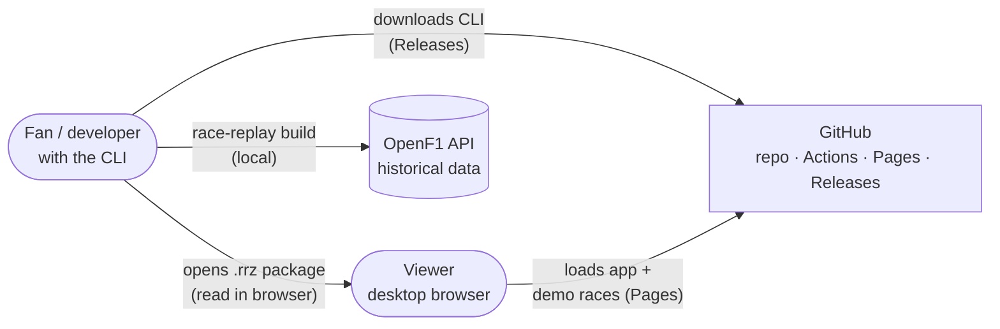
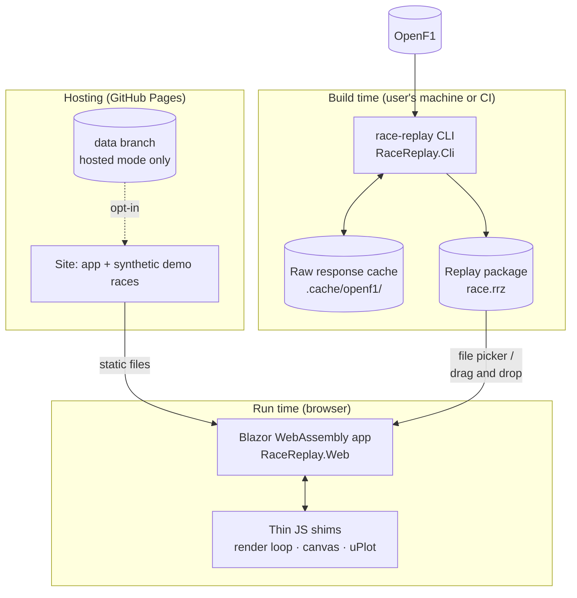
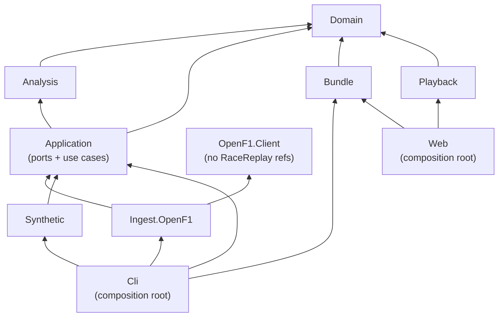
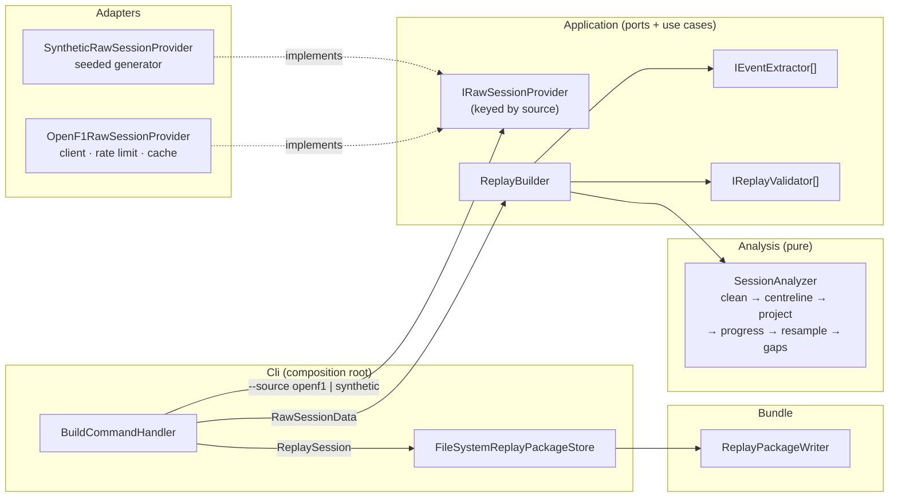
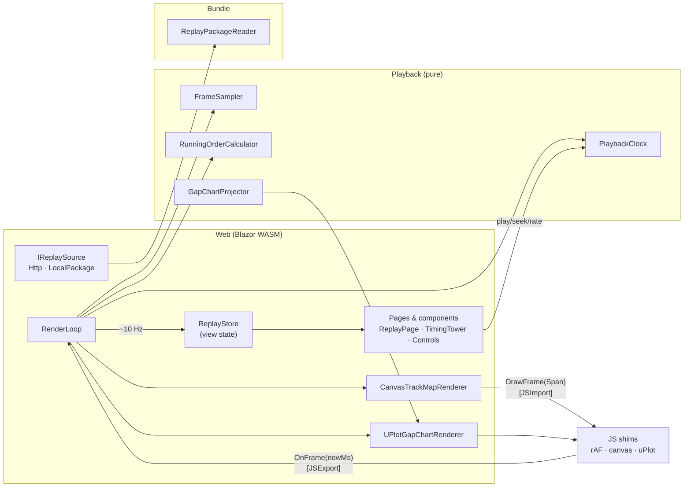
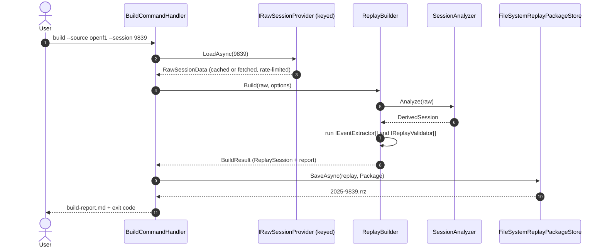
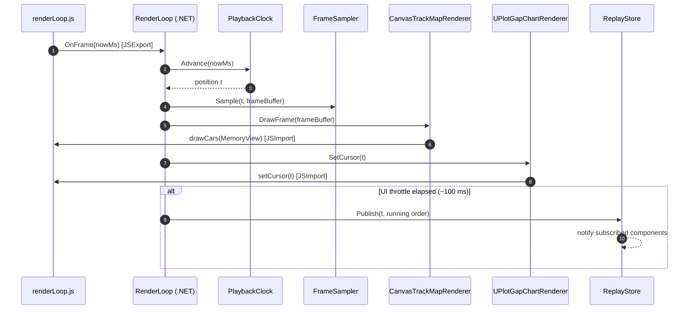
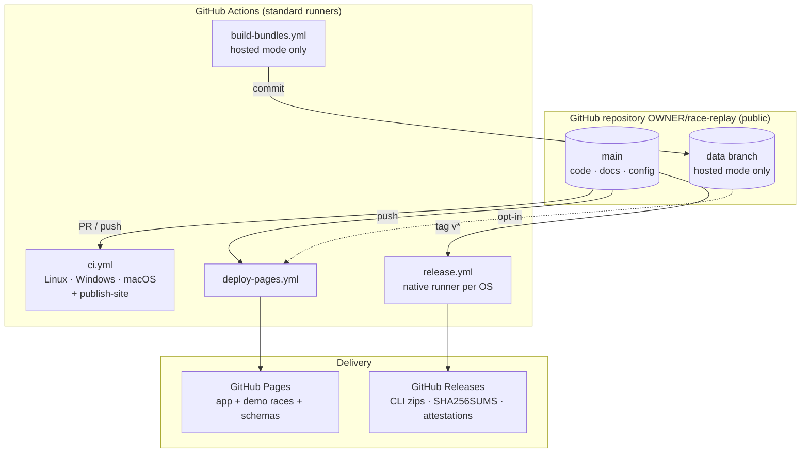

# 02 — Architecture

## 1. Architectural drivers

The shape of the system follows from a handful of forces:

1. **Irregular, noisy, rate-limited input.** Raw data must be cleaned, aligned and enriched before it is useful. That is expensive and should happen once (NFR-03, constraint "rate limits").
2. **Instant seeking at 60 fps.** The browser must be able to answer "where is every car at time *t*?" in constant time (NFR-01, NFR-02).
3. **GitHub hosting, zero cost.** The project is a public repository on GitHub Free (ADR-0010). Pages is a static host with fixed behaviour, so no server runs at view time and the client adapts to Pages (NFR-10).
4. **No redistribution of real data by default.** Real races are built and opened locally. The public site shows synthetic races (ADR-0008, NFR-12).
5. **All C#.** Shared code (domain types, bundle reader) should compile for both the CLI and WebAssembly.
6. **Testability and changeability.** Pure core logic, adapters at the edges, enforced dependency direction (NFR-06, NFR-07).

These drivers lead to a **build-time / run-time split** (ADR-0002):

- At build time, a .NET CLI turns raw data into replay packages. The raw data is either OpenF1 or a seeded synthetic race.
- At run time, a Blazor WebAssembly client plays packages. These come either from the site (demo races, or real races in hosted mode) or from the user's own disk.

## 2. System context



| External system | Interaction | Notes |
|---|---|---|
| OpenF1 API | Read-only HTTPS GET, from the user's CLI (and from CI only in hosted mode) | Free historical tier. 3 req/s and 30 req/min. CC BY-NC-SA 4.0. |
| GitHub | Source control, CI/CD (Actions), static hosting (Pages) of the app and synthetic demo races, CLI downloads (Releases), security tooling; optional `data` branch in hosted mode | ADR-0007, ADR-0008, ADR-0010 |
| Viewer's browser | Downloads the WebAssembly app and demo bundles; reads local packages chosen by the user | Never calls OpenF1. Never uploads a local package. |

## 3. Containers



| Container | Technology | Responsibility |
|---|---|---|
| `race-replay` CLI | .NET 10 console app, Generic Host, System.CommandLine 2.0 | List sessions; build real or synthetic replays; validate, inspect and package them; generate the catalogue |
| Raw response cache | Files on disk (CI: `actions/cache`, hosted mode only) | Make rebuilds free and deterministic. Respect rate limits. |
| Replay package (`.rrz`) | ZIP of manifest plus binary channels plus data notice | What users open in the app (ADR-0008) |
| Pages site | Static files on GitHub Pages | App plus synthetic demo races. Real bundles only in hosted mode. |
| Releases | GitHub Releases | Self-contained CLI per platform, checksums, build-provenance attestations; immutable once published |
| Data branch | Orphan Git branch `data` | Hosted mode only (ADR-0007) |
| Web app | Blazor WebAssembly standalone, .NET 10 | UI, playback engine, loading from site or local file, all state |
| JS shims | ES modules (~200 lines total) plus vendored uPlot | `requestAnimationFrame`, canvas drawing, chart rendering (ADR-0003) |

## 4. Dependency rules

### 4.1 Solution layout

```text
race-replay/
├─ RaceReplay.slnx
├─ src/
│  ├─ RaceReplay.Domain/          # Entities, value objects, raw records. No dependencies.
│  ├─ RaceReplay.Analysis/        # Pure algorithms: track model, projection, progress, resampling, gaps, order
│  ├─ RaceReplay.Application/     # Ports + use cases: build/validate a replay; event extractors; validators
│  ├─ RaceReplay.Bundle/          # Format: manifest, .rrb channels, .rrz packages ↔ ReplaySession
│  ├─ OpenF1.Client/              # Reusable OpenF1 client: DTOs, JSON context, cache, rate limiting, resilience
│  ├─ RaceReplay.Ingest.OpenF1/   # Adapter: maps OpenF1.Client DTOs → domain; implements the ports
│  ├─ RaceReplay.Synthetic/       # Adapter: seeded synthetic races (tracks, cars, incidents, faults) → ports
│  ├─ RaceReplay.Playback/        # Client engine: clock, frame sampler, running order, chart data
│  ├─ RaceReplay.Cli/             # Composition root for build time; file-system package store
│  └─ RaceReplay.Web/             # Composition root for run time (Blazor WASM + JS shims)
└─ tests/
   ├─ RaceReplay.Domain.Tests/
   ├─ RaceReplay.Analysis.Tests/
   ├─ RaceReplay.Application.Tests/
   ├─ RaceReplay.Bundle.Tests/
   ├─ OpenF1.Client.Tests/
   ├─ RaceReplay.Ingest.OpenF1.Tests/
   ├─ RaceReplay.Synthetic.Tests/
   ├─ RaceReplay.Playback.Tests/
   ├─ RaceReplay.Cli.Tests/
   ├─ RaceReplay.Web.Tests/       # Component tests (added in M5)
   ├─ RaceReplay.Architecture.Tests/
   └─ RaceReplay.TestKit/         # Contract base classes, fixture loader, assertion helpers (not a test project)
```

### 4.2 Allowed references



| Project | May reference (RaceReplay.*) | Must **not** reference |
|---|---|---|
| Domain | — | Anything in RaceReplay; `System.Net.Http`; `System.Text.Json`; `Microsoft.AspNetCore.*` |
| Analysis | Domain | Application, Bundle, Ingest, Synthetic, Playback, Web, Cli |
| Application | Domain, Analysis | Bundle, Ingest, Synthetic, Playback, Web, Cli |
| Bundle | Domain | Analysis, Application, Ingest, Synthetic, Playback |
| OpenF1.Client | — (no RaceReplay assemblies; packable on its own) | Anything in RaceReplay |
| Ingest.OpenF1 | Domain, Application, OpenF1.Client | Bundle, Synthetic, Playback, Web, Cli |
| Synthetic | Domain, Application | Bundle, Ingest, Playback, Web, Cli |
| Playback | Domain | Analysis, Application, Bundle, Ingest, Synthetic, Web |
| Cli | Application, Analysis, Bundle, Ingest, Synthetic, Domain | Playback, Web |
| Web | Playback, Bundle, Domain | Analysis, Application, Ingest, Synthetic, Cli |

The rules are enforced by `RaceReplay.Architecture.Tests` ([06 §8](06-testing-strategy.md#8-architecture-tests)). The guiding ideas are:

- **Dependencies point inward.**
- **Ports are owned by Application**, the layer that uses them. Adapters (OpenF1, Synthetic, the file-system package store in Cli) depend on Application, never the other way round (ADR-0009). This matches the racesim project's convention.
- **Algorithms never see I/O.**
- **The OpenF1 client is independent.** `OpenF1.Client` knows nothing about Race Replay. It can be published and shared with racesim without changing either project's ports (racesim ADR-0009 Part 2; [07 §9.3](07-repository-ci-and-delivery.md#93-packages-and-the-shared-openf1-client)).
- **The browser never ships build-time code.** Web does not reference Analysis, Application or either adapter, which keeps the WebAssembly download small. Bundle depends only on Domain, so the package *writer* (Bundle) and the file-system *store* (Cli) are separate types.

### 4.3 WebAssembly compatibility

Domain, Bundle and Playback are loaded into the browser. They therefore:

- are trim-safe (no unbounded reflection; `IsTrimmable=true`, `EnableTrimAnalyzer=true`);
- use System.Text.Json **source generation** only;
- avoid file system, threads and `Process`. Packages are read from in-memory streams;
- avoid large dependencies.

## 5. Components

### 5.1 Build time



### 5.2 Run time



## 6. SOLID in practice

SOLID here is concrete, not decorative. Each principle maps to specific design choices that a reviewer can check. SOLID is also a means, not an end: **an interface exists only where there is a real seam** (ADR-0009). That means more than one implementation, an external boundary, or a test that needs a substitute. Pure, deterministic classes such as the analysis steps are sealed concrete classes and are tested directly.

### Single Responsibility

- Each Analysis step is one class with one reason to change. For example:
  - `TrackProjector` only maps (x, y) → (s, lateral error).
  - `ProgressUnwrapper` only turns wrapped *s* into gated, monotonic *d*.
  - `GapCalculator` only computes gaps from progress.
- Loading data, building a replay and storing it are separate:
  - `IRawSessionProvider` loads.
  - `ReplayBuilder` derives, extracts and validates.
  - `IReplayPackageStore` persists.

  The CLI handler composes them.
- Playback separates *time* (`PlaybackClock`), *state at time t* (`FrameSampler`), *ordering* (`RunningOrderCalculator`) and *drawing* (renderers in Web).
- The OpenF1 adapter separates transport (`OpenF1Client`), politeness (`RateLimitingHandler`), persistence (`ResponseCacheHandler`) and translation (mappers inside `OpenF1RawSessionProvider`).

### Open/Closed

- **Data sources** are keyed implementations of `IRawSessionProvider` (`"openf1"`, `"synthetic"`), resolved with .NET keyed services from the CLI's `--source` option. Adding a provider is a new adapter project and one registration. No existing code changes.
- **Event extraction** is a collection of `IEventExtractor`s, resolved as `IEnumerable<IEventExtractor>`. Adding an "overtake" or "fastest lap" marker means adding a class and one registration. `ReplayBuilder` does not change.
- **Validation** works the same way with `IReplayValidator`: monotonic progress, plausibility, gap accuracy, running order.
- **Replay sources in the browser** (`IReplaySource`: HTTP or local package) follow the same pattern.
- **Playback behaviours** such as red-flag skipping are clock decorators (`SegmentSkippingClock : IPlaybackClock`), not edits to the clock.
- The **core analysis chain is deliberately explicit**, not a generic step list. Its stages have different input/output types, and compile-time checking of that chain is worth more than plug-in flexibility it doesn't need.

### Liskov Substitution

- Every `IRawSessionProvider` must honour one contract:
  - samples are UTC and strictly ascending per driver;
  - laps are ordered;
  - unknown session keys raise `SessionNotFoundException`;
  - cancellation is honoured.
- The contract is written once as an **abstract xUnit test class** (`RawSessionProviderContract`). It runs against the OpenF1 provider (on recorded fixtures) **and** the synthetic provider ([06 §6](06-testing-strategy.md#6-contract-tests)). Because the synthetic source is a production adapter, the "fake" can't drift from the contract.
- `PlaybackClock` and `SegmentSkippingClock` share a clock contract test.

### Interface Segregation

- **Loading is separate from browsing.**
  - `ISessionCatalogSource` lists sessions, for the `sessions` command.
  - `IRawSessionProvider` loads one session.

  A synthetic provider needs no catalogue.
- **The clock is split by role.**
  - `IPlaybackClockReader` (position, rate, state) is for components that display time.
  - `IPlaybackControl` (play, pause, seek, rate) is for controls.
  - Only the render loop needs `IPlaybackClock`, which combines both and adds `Advance`.
- **Renderers expose only what the loop needs:** `ITrackMapRenderer.DrawFrame(...)` and `IGapChartRenderer.SetCursor(...)`.

### Dependency Inversion

- Application owns its ports. Adapters implement them. Composition happens only in `RaceReplay.Cli/Program.cs` and `RaceReplay.Web/Program.cs`.
- Analysis and Playback depend only on Domain types. They never touch HTTP, files, JS or Blazor.
- Wall-clock time is injected via `TimeProvider` wherever it matters: cache freshness, build report timestamps, synthetic "retrieved" stamps. Tests use `FakeTimeProvider`. The playback clock takes explicit frame timestamps from `requestAnimationFrame`, so it needs no time source.

### Supporting practices

- **Functional core, imperative shell.** Analysis and Playback are deterministic functions of their inputs. Side effects live in Cli, the adapters and Web.
- **Immutability by default.** Domain types are `record`/`readonly record struct`. Large numeric channels are immutable arrays wrapped in read-only views after construction.
- **Options pattern.** Every tunable algorithm parameter is an options record validated at startup (`ValidateOnStart`), with defaults documented in [03 §9](03-domain-and-algorithms.md#9-parameters).

## 7. Key abstractions

```csharp
namespace RaceReplay.Application.Ports;

/// One implementation per data source, registered as a keyed service ("openf1", "synthetic").
public interface IRawSessionProvider
{
    /// Samples are UTC and strictly ascending per driver; laps ordered by (driver, lap).
    /// Throws SessionNotFoundException for keys outside this provider's range.
    Task<RawSessionData> LoadAsync(SessionKey session, CancellationToken ct);
}

public interface ISessionCatalogSource
{
    Task<IReadOnlyList<SessionInfo>> ListSessionsAsync(int year, string? sessionType, CancellationToken ct);
}

public interface IReplayPackageStore
{
    Task<string> SaveAsync(ReplaySession replay, PackageLayout layout, CancellationToken ct); // returns path
}
```

Synthetic races use a reserved key range (`SessionKey.Synthetic(seed)`), so one signature serves both providers without type checks or downcasts.

```csharp
namespace RaceReplay.Application;

public interface IEventExtractor
{
    IEnumerable<RaceEvent> Extract(RawSessionData raw, DerivedSession derived);
}

public interface IReplayValidator
{
    ValidationResult Validate(ReplaySession replay, RawSessionData raw);
}

// Derives, extracts and validates. Deliberately free of I/O.
public sealed class ReplayBuilder(
    SessionAnalyzer analyzer,                  // concrete: pure, no seam needed
    IEnumerable<IEventExtractor> extractors,
    IEnumerable<IReplayValidator> validators,
    TimeProvider time,
    ILogger<ReplayBuilder> log)
{
    public BuildResult Build(RawSessionData raw, BuildOptions options);
}
```

```csharp
namespace RaceReplay.Cli;

public sealed class BuildCommandHandler(
    IServiceProvider services,                 // resolves the keyed provider chosen by --source
    ReplayBuilder builder,
    IReplayPackageStore store,
    IBuildReportWriter reports)
{
    public async Task<int> RunAsync(string source, SessionKey session, PackageLayout layout, CancellationToken ct)
    {
        var provider = services.GetRequiredKeyedService<IRawSessionProvider>(source);
        RawSessionData raw = await provider.LoadAsync(session, ct);
        BuildResult result = builder.Build(raw, BuildOptions.Default);
        string path = await store.SaveAsync(result.Replay, layout, ct);
        await reports.WriteAsync(result.Report, ct);
        return result.Report.HasFailures ? ExitCodes.ValidationFailed : ExitCodes.Success;
    }
}
```

```csharp
namespace RaceReplay.Analysis;

// Composes the explicit, typed analysis chain. All concrete, sealed, deterministic.
public sealed class SessionAnalyzer(
    LocationCleaner cleaner,
    CentrelineBuilder centreline,
    TrackProjector projector,
    ProgressUnwrapper unwrapper,
    TimelineResampler resampler,
    GapCalculator gaps)
{
    public DerivedSession Analyze(RawSessionData raw);
}
```

`BuildCommandHandler` coordinates I/O. `ReplayBuilder` coordinates extension points and reporting. `SessionAnalyzer` coordinates pure computation. Each constructor stays small, and the whole analysis chain can be tested without the CLI or any adapter.

```csharp
namespace RaceReplay.Playback;

public interface IPlaybackClockReader
{
    double Position { get; }   // seconds since replay t0
    double Duration { get; }
    double Rate { get; }
    bool IsPlaying { get; }
}

public interface IPlaybackControl
{
    void Play();
    void Pause();
    void Seek(double position);
    void SetRate(double rate);
    void BeginScrub();
    void EndScrub();
}

public interface IPlaybackClock : IPlaybackClockReader, IPlaybackControl
{
    /// Advances using the rAF timestamp (ms). Returns the new position.
    double Advance(double frameTimestampMs);
}

// Concrete: one implementation, tested directly.
public sealed class FrameSampler(ReplaySession replay)
{
    public int Stride => 4;                                  // doubles per car in the frame buffer
    public void Sample(double position, Span<double> frame); // O(cars), allocation-free
}
```

## 8. Runtime views

### 8.1 Building a replay package



With `--source synthetic --seed 7`, only step 2 differs: the synthetic provider generates `RawSessionData` from the seed. Everything after it runs the same code.

### 8.2 One animation frame



Per frame there are exactly three interop transitions:

1. `OnFrame` into .NET;
2. `drawCars` out to JS, carrying the frame buffer;
3. `setCursor` out to JS, carrying a single double.

The frame buffer is a reused `double[]` passed as a zero-copy `Span<double>` ([05 §5](05-web-client.md#5-javascript-interop)).

## 9. Cross-cutting concerns

| Concern | Approach |
|---|---|
| **Configuration** | `appsettings.json` plus environment variables plus CLI options, bound to options records with data annotations and `ValidateOnStart()`. The web client reads `appsettings.json` from `wwwroot`, including the bundle mode (`Demo` or `Hosted`). |
| **Logging** | `Microsoft.Extensions.Logging` throughout. The CLI uses console output (simple formatter locally, JSON in CI). The web app logs to the browser console at Warning and above in Release. Source-generated `[LoggerMessage]` methods on hot paths. |
| **Errors** | Exceptions for programmer errors and unrecoverable I/O. Expected data problems (dropped samples, rejected progress steps, unmatched laps) are collected as **diagnostics** in the build report, not thrown. The CLI maps outcomes to exit codes ([04 §6](04-data-pipeline-and-bundle-format.md#6-cli)). |
| **Determinism** | No `DateTime.Now`, no unordered dictionary enumeration in outputs, invariant culture for formatting, fixed rounding when quantising. Reductions that are persisted (sums, averages) use scalar loops in a fixed order. `TensorPrimitives` is used only for exact operations (min, max) in persisted outputs. The guarantee is byte-identical output **on the same platform and SDK**, with CI as the reference build (NFR-11). |
| **Data policy** | No real data on the public site by default. Local packages are read in the browser and never uploaded. The deploy workflow rejects non-synthetic manifests unless hosted mode is on (ADR-0008). |
| **Security** | No secrets. All network calls are outbound HTTPS GETs to a public API. Bundles and packages are untrusted input to the reader: bounds checks, size limits, ZIP entry-name allow-list (no path traversal), length checks; checksum verification in the CLI. No `unsafe` code outside source-generated interop. |
| **Licensing** | Code under MIT. Real packages carry CC BY-NC-SA 4.0 and OpenF1 attribution in the manifest and a `DATA-NOTICE.txt`. The UI shows attribution whenever a real package is open. Synthetic demo races carry no third-party data. |
| **Observability** | The build report (Markdown plus JSON) records sample counts, dropped and rejected samples, projection error stats, validation results and sizes. In CI it is written to the job summary. |
| **Supply chain** | GitHub-owned actions only, pinned by SHA; least-privilege workflow tokens; Dependabot for NuGet, the .NET SDK and Actions; attested, immutable releases (NFR-13, [07 §7](07-repository-ci-and-delivery.md#7-supply-chain-and-security)). |
| **Platform fit** | Pages can't send headers or negotiate compression, so the client decodes Brotli itself, relies on fingerprinting, and reads its site mode from the catalogue rather than from edited app files ([05 §12](05-web-client.md#12-github-pages-specifics)). |
| **Globalisation** | Times are shown as race clock (`h:mm:ss`) and lap numbers. No locale-dependent formatting. The web app uses invariant globalisation. |

## 10. .NET platform features used

| Feature | Where | Why |
|---|---|---|
| **.NET 10 LTS, C# 14** | All projects | Current LTS, supported until November 2028 (ADR-0001) |
| C# 14 **extension members** | Analysis, Playback | Readable helpers on spans, e.g. `extension(ReadOnlySpan<float> v) { public float Max => ...; }` |
| C# 14 **`field` keyword** | Options and clock | Validation in property setters without boilerplate backing fields |
| C# 14 **implicit span conversions** | Analysis, Bundle | Pass arrays to span-based APIs naturally on hot paths |
| **`.slnx` solution format** | Repo root | Default for `dotnet new sln` in .NET 10. Readable XML, merge-friendly. |
| **Central Package Management** | `Directory.Packages.props` | One place for versions. Dependabot-friendly. |
| **Microsoft Testing Platform + xUnit v3** | Tests | Native `dotnet test` support in .NET 10 via `global.json` (ADR-0006) |
| **Keyed DI services** (`AddKeyedTransient`, `GetRequiredKeyedService`) | Cli | Select the data source (`openf1`, `synthetic`) by name without conditionals |
| **System.Text.Json source generation** | Ingest, Bundle | Trim/AOT-safe, faster. Required for WebAssembly. |
| **`JsonSchemaExporter`** (System.Text.Json, .NET 9+) | Bundle, tests | Generate a JSON Schema for `manifest.json` from the DTOs; golden-tested |
| `JsonSerializer.DeserializeAsyncEnumerable` | Ingest | Stream large location responses without buffering whole arrays |
| **System.Threading.RateLimiting** | Ingest | Chained 3/s and 30/min limiters as a `DelegatingHandler` |
| **Microsoft.Extensions.Http.Resilience** | Ingest | Standard retry with jitter, timeouts and circuit breaker. Honours `Retry-After` on 429. |
| **Generic Host** (`Host.CreateApplicationBuilder`) | Cli | DI, configuration, logging, options validation |
| **System.CommandLine 2.0** (stable since Nov 2025) | Cli | Commands, options, `SetAction`, tab completion |
| **`TimeProvider` / `FakeTimeProvider`** | Ingest, Application, Synthetic, tests | Testable time |
| `Span<T>`, `MemoryMarshal`, `BinaryPrimitives`, `ArrayPool<T>` | Bundle, Playback | Zero-copy parsing and allocation-free frame sampling |
| `System.IO.Compression.ZipArchive` | Bundle | Single-file `.rrz` packages, read from memory in the browser |
| **System.Numerics.Tensors `TensorPrimitives`** | Bundle, Analysis | Vectorised min/max for bounds and quantisation (exact operations only in persisted outputs) |
| `FrozenDictionary<TKey,TValue>` | Domain, Playback | Fast read-only lookups (driver number → index) |
| **Blazor WebAssembly** (standalone) with `InputFile` | Web | All-C# client. Static hosting (ADR-0003). Local package opening without upload. |
| **`[JSImport]`/`[JSExport]`** (`System.Runtime.InteropServices.JavaScript`) | Web | Low-overhead interop with `Span<double>` → `MemoryView` marshalling |
| Trimming, invariant globalisation, static asset fingerprinting | Web | Smaller download, cache-busting on GitHub Pages |
| Optional **WebAssembly AOT** (`RunAOTCompilation`) | Web | Performance lever if the interpreter or jiterpreter falls short (decided in M7) |
| Optional **Native AOT** / self-contained single-file CLI | Cli | Release builds users can run without the SDK (A5) |
| **File-based apps** (`dotnet run script.cs`) | `scripts/` | Small dev utilities (coverage gate, exploration) without extra projects |

**Deliberately not used**

- **.NET Aspire:** there are no services to orchestrate.
- **Entity Framework:** there is no database.
- **Blazor Server or Interactive Auto modes:** they need a server at run time.
- **C# 15 union types:** these ship with .NET 11. They would model `RaceEvent` neatly and are noted for a future upgrade.

## 11. Quality attribute scenarios

| Attribute | Scenario | Response |
|---|---|---|
| Performance | User drags the scrubber across the full race at 60 Hz | Each drag event calls `Seek`. The next frame samples in O(cars). No allocation, no data loading. |
| Modifiability | Add a "fastest lap" marker | New `FastestLapExtractor : IEventExtractor` plus registration plus tests. The bundle event list is already polymorphic. No other code changes. |
| Modifiability | Add a second real-data provider | New `RaceReplay.Ingest.X` adapter implementing `IRawSessionProvider`, registered under a new key. Inherit the contract tests. |
| Testability | Verify gap maths without network | Synthetic constant-speed cars on a circular track give analytic expected gaps ([06 §5](06-testing-strategy.md#5-synthetic-fixtures)). |
| Robustness | One projection snaps 200 m ahead | Re-acquisition rule, plausibility gate and envelope speed limit. A regression test asserts gaps are unchanged. |
| Onboarding | Contributor with no OpenF1 access | `race-replay build --source synthetic --seed 1` then `dotnet watch` plays a race locally |
| Reliability | OpenF1 returns 429 or a timeout mid-build | Rate limiter prevents most 429s. The resilience handler retries with jitter. Cached responses survive restarts, so a rerun resumes where it stopped. |
| Compliance | Someone accidentally commits a real bundle into the demo set | `assemble-site.sh`, run by CI and deploy, checks every manifest's `provenance.source` and fails unless hosted mode is enabled |
| Portability | A Windows user builds a package with the CLI | CI builds and tests on Windows and macOS as well as Linux. Releases ship native binaries built on each OS. |

## 12. Deployment view (GitHub)



| Container | GitHub service | Workflow | Configured by |
|---|---|---|---|
| Web app and demo races | Pages (Actions source) | `deploy-pages.yml` via `scripts/assemble-site.sh` | `setup-github.sh`; `github-pages` environment limited to `main` |
| CLI | Releases (immutable) | `release.yml` | Tag ruleset `v*`; release immutability setting |
| Real-race bundles (opt-in) | `data` branch plus Pages | `build-bundles.yml` | `HOSTED_BUNDLES` variable; `data` ruleset |
| Source and quality gates | Repository plus Actions | `ci.yml` | `main` ruleset requiring the four CI checks |
