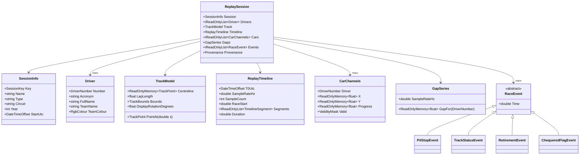

# 03 — Domain model & algorithms

This document defines the domain vocabulary and the algorithms that turn raw position samples into a replayable session. Everything here lives in `RaceReplay.Domain` (types) and `RaceReplay.Analysis` (algorithms). All of it is pure, deterministic and unit-testable without I/O. The analysis steps are sealed concrete classes, because they have one implementation and no test seam (ADR-0009). They are tested directly against synthetic races.

## 1. From raw to replayable

| Stage | Input | Output | Component |
|---|---|---|---|
| Load | OpenF1 endpoints, or a seed | `RawSessionData` | `IRawSessionProvider` (Application port, implemented by the OpenF1 or Synthetic adapter) |
| Clean | Raw location samples per driver | `CleanTrace` (sorted, de-duplicated, outliers removed, gap-split) | `LocationCleaner` |
| Track model | Clean traces of reference laps | `TrackModel` (centreline, lap length, start/finish) | `CentrelineBuilder` |
| Project | Clean trace + track | `ProjectedTrace` (s, lateral error per sample) | `TrackProjector` |
| Unwrap | Projected trace + lap anchors | `ProgressTrace` (monotonic race progress *d*) | `ProgressUnwrapper` |
| Resample | Progress traces + timeline | `CarChannels` (x, y, d, validity on the fixed grid) | `TimelineResampler` |
| Gaps | All car channels | `GapSeries` (gap to virtual leader per car) | `GapCalculator` |
| Events | Raw timing data + derived session | `RaceEvent[]`, `TimelineSegment[]` | `IEventExtractor`s |
| Assemble | All of the above | `ReplaySession` | `ReplayBuilder` |

## 2. Domain model



### 2.1 Value objects

Small, immutable, equality-by-value types prevent primitive obsession (for example, passing a session key where a driver number was expected).

```csharp
namespace RaceReplay.Domain;

public readonly record struct SessionKey(int Value);
public readonly record struct DriverNumber(int Value);
public readonly record struct TrackPoint(float X, float Y);
public readonly record struct TrackBounds(float MinX, float MinY, float MaxX, float MaxY);

public readonly record struct RgbColour(byte R, byte G, byte B)
{
    public static RgbColour FromHex(ReadOnlySpan<char> hex) =>   // "3671C6"
        new(byte.Parse(hex[0..2], NumberStyles.HexNumber, CultureInfo.InvariantCulture),
            byte.Parse(hex[2..4], NumberStyles.HexNumber, CultureInfo.InvariantCulture),
            byte.Parse(hex[4..6], NumberStyles.HexNumber, CultureInfo.InvariantCulture));
}

/// A gap as reported by timing: seconds, laps behind, or not applicable (leader).
public readonly record struct GapValue(GapKind Kind, double Seconds, int Laps)
{
    public static readonly GapValue None = new(GapKind.None, 0, 0);
    public static GapValue FromSeconds(double s) => new(GapKind.Seconds, s, 0);
    public static GapValue FromLaps(int laps) => new(GapKind.Laps, 0, laps);
}
public enum GapKind { None, Seconds, Laps }
```

### 2.2 Raw records (port outputs)

```csharp
public readonly record struct RawLocationSample(DateTimeOffset Timestamp, DriverNumber Driver, int X, int Y, int Z);
public sealed record RawLap(DriverNumber Driver, int LapNumber, DateTimeOffset? Start, double? Duration, bool IsPitOutLap);
public sealed record RawPitStop(DriverNumber Driver, int Lap, DateTimeOffset Timestamp, double? LaneDuration, double? StopDuration);
public sealed record RaceControlMessage(DateTimeOffset Timestamp, string Category, string? Flag,
                                        string? Scope, int? Lap, DriverNumber? Driver, string Message);
public sealed record RawInterval(DateTimeOffset Timestamp, DriverNumber Driver, GapValue GapToLeader, GapValue Interval);
public sealed record RawPositionChange(DateTimeOffset Timestamp, DriverNumber Driver, int Position);
public sealed record SessionResult(DriverNumber Driver, int? Position, bool Dnf, bool Dns, bool Dsq, int LapsCompleted);

public sealed record RawSessionData(
    SessionInfo Session,
    IReadOnlyList<Driver> Drivers,
    IReadOnlyDictionary<DriverNumber, IReadOnlyList<RawLocationSample>> Locations,
    IReadOnlyList<RawLap> Laps,
    IReadOnlyList<RawPitStop> PitStops,
    IReadOnlyList<RaceControlMessage> RaceControl,
    IReadOnlyList<RawInterval> Intervals,              // validation only (gaps)
    IReadOnlyList<RawPositionChange> PositionChanges,  // validation only (running order)
    IReadOnlyList<SessionResult> Results);
```

### 2.3 Events and segments

C# 14 has no discriminated unions, so events are a closed `abstract record` hierarchy consumed with pattern matching. When the project moves to .NET 11 / C# 15, this is a natural candidate for union types.

```csharp
public abstract record RaceEvent(double Time);
public sealed record PitStopEvent(double Time, DriverNumber Driver, int Lap,
                                  double? LaneDuration, double? StopDuration) : RaceEvent(Time);
public sealed record TrackStatusEvent(double Time, double? EndTime, TrackStatus Status) : RaceEvent(Time);
public sealed record RetirementEvent(double Time, DriverNumber Driver, int Lap) : RaceEvent(Time);
public sealed record ChequeredFlagEvent(double Time) : RaceEvent(Time);

public enum TrackStatus { Green, Yellow, SafetyCar, VirtualSafetyCar, RedFlag }

public readonly record struct TimelineSegment(double Start, double End, SegmentKind Kind);
public enum SegmentKind { PreRace, Racing, Suspended, PostRace }
```

All `Time` values are **seconds since `ReplayTimeline.T0Utc`**. Absolute timestamps exist only at the edges: in raw records, and in the manifest as `t0Utc`.

## 3. Coordinates, units and time

- **Coordinates.** OpenF1 `x`, `y`, `z` are integers in a per-circuit Cartesian frame with an arbitrary origin. Their units are believed to be **decimetres** (FastF1 documents the same feed in 1/10 m). Spike S1 confirms this by comparing the built centreline length with the official circuit length. The domain keeps the native units ("track units"). `TrackModel.UnitsPerMetre` (default 10) converts to metres for display and for speed-based thresholds.
- **Height (`z`)** is carried through cleaning but not used. It is not stored in bundles.
- **Lateral placement.** OpenF1 describes location as approximate and *lacking lateral detail*. The design therefore never infers left/right track position.
- **Time.** Internally, time is `double` seconds relative to `T0Utc`, which is the first sample time rounded down to a whole second. `DateTimeOffset` appears only at the edges. Double precision gives sub-microsecond resolution over a day, which is far more than needed.

## 4. Cleaning

`LocationCleaner` turns a raw per-driver stream into one or more continuous runs.

1. **Sort and de-duplicate** by timestamp. Keep the last sample for identical timestamps.
2. **Drop placeholder samples** where `x == y == z == 0`. These are seen in live-timing-derived position feeds for cars not on track; spike S1 confirms how often they appear.
3. **Reject spikes.** A sample *pᵢ* is an outlier if:
   - its implied speed from *pᵢ₋₁* **and** to *pᵢ₊₁* both exceed `MaxSpeed` (default 120 m/s ≈ 430 km/h), **and**
   - *pᵢ₋₁* → *pᵢ₊₁* is itself plausible.

   This removes isolated glitches without deleting real high-speed motion.
4. **Split on gaps.** If Δt between consecutive samples exceeds `MaxGap` (default 2.0 s), the trace is split into separate runs. Later stages never interpolate across a split. Those grid points are marked invalid instead.
5. **Report.** The counts of dropped, de-duplicated and split samples go into the build diagnostics.

## 5. Track model (centreline)

### 5.1 Reference laps

A good centreline comes from clean, representative laps. `CentrelineBuilder` selects up to `ReferenceLapCount` (default 5) laps, taken from different drivers where possible, that satisfy all of:

- not lap 1, not a pit-out lap, and not an in-lap (the next lap is a pit-out lap);
- `Duration` within 107 % of the median green-flag lap time;
- no overlap with safety car, virtual safety car or red-flag windows;
- location samples cover the lap with no split.

The fastest qualifying laps are preferred.

### 5.2 Building the polyline

```text
for each reference lap:
    P  ← samples in [lap.Start, lap.Start + lap.Duration]
    P' ← resample P uniformly by arc length into M points   (M = ⌈length / Spacing⌉, Spacing = 5 m)
base ← first reference lap
for each other lap Q:
    k* ← argmin_k Σ |base[i] − Q[(i + k) mod M]|²            (circular alignment, O(M²); M ≈ 1000)
    Q  ← Q rotated by k*
C  ← point-wise mean of aligned laps
C  ← circular moving average, window W = 5                     (removes residual jitter)
C  ← resample by arc length to final spacing; close the loop
L  ← total arc length; cumulative[i] = arc length to point i
```

Because the laps are resampled to the same point count before averaging, they also need the same arc length. Each lap is normalised to the base lap's length before alignment. Laps whose length differs from the median by more than 2 % are discarded.

### 5.3 Start/finish and orientation

- **Start/finish (s = 0).** Lap `date_start` values are documented as approximate. The builder therefore collects every car's projected *s* at every lap boundary in the session and takes the circular median. The centreline is then rotated so that this point is index 0.
- **Direction.** *s* increases in the direction of travel by construction.
- **Display rotation.** The default is a PCA-based rotation that lays the circuit out "landscape". A small checked-in override file, `config/track-orientation.json` keyed by OpenF1 `circuit_key`, allows broadcast-style orientation. The meetings endpoint also links to third-party circuit info that includes a rotation, but its licensing is unclear, so it is not used by default.

### 5.4 Spatial index

For global searches (§6.2) the centreline segments are bucketed into a uniform grid with cell size about 2 × spacing. A query inspects the 3 × 3 neighbourhood. This is built once per track and is O(1) per lookup on average.

## 6. Projection and race progress

### 6.1 Projecting a point

For a point *p* and segment *[cᵢ, cᵢ₊₁]*:

```csharp
static (double t, double dist2) ClosestOnSegment(TrackPoint p, TrackPoint a, TrackPoint b)
{
    double abx = b.X - a.X, aby = b.Y - a.Y;
    double t = Math.Clamp(((p.X - a.X) * abx + (p.Y - a.Y) * aby) / (abx * abx + aby * aby), 0, 1);
    double dx = a.X + t * abx - p.X, dy = a.Y + t * aby - p.Y;
    return (t, dx * dx + dy * dy);
}
// s = cumulative[i] + t · |cᵢ₊₁ − cᵢ|,   lateralError = √dist2
```

### 6.2 Continuity-constrained search

A naive nearest-segment search snaps to the wrong part of the track wherever the circuit passes close to itself: hairpins, parallel straights, Suzuka's crossover, and pit lanes running beside the main straight. `TrackProjector` uses the previous sample's segment as a **hint**:

- It searches segments in the circular window `[hint − Back, hint + Ahead]`.
- `Ahead` covers the furthest a car can travel between samples: `MaxSpeed × MaxGap / Spacing` plus a margin.
- `Back` is small (default 3 segments) to tolerate jitter.
- If there is no hint (first sample of a run), or the best lateral error exceeds `MaxLateralError` (default 40 m), it falls back to a **global search** via the spatial index.
- **Re-acquisition rule.** A global-search result that is discontinuous with the previous projection is only a *candidate*. It is accepted after `ReacquireConfirmSamples` consecutive samples (default 3) project consistently from it, meaning their progress steps are physically plausible. Until then, the sample is marked unprojected, as if it were a dropout. A single wrong snap to a nearby part of the track (a parallel straight, the other branch of a crossover) is therefore never accepted.
- Samples whose lateral error exceeds `MaxLateralError` are still projected, but flagged `OffCentreline` in diagnostics. Inside a known pit window (from the `pit` endpoint) the tolerance is relaxed to `PitLateralTolerance` (default 80 m).

### 6.3 Unwrapping and lap anchoring

The projected *s* wraps from *L* back to 0 at the start/finish line. `ProgressUnwrapper` produces monotonic race progress *d*:

```csharp
double laps = 0, prev = s[0];
for (int k = 0; k < s.Length; k++)
{
    double ds = s[k] - prev;
    if (ds < -L / 2) laps++;          // crossed the line forwards
    else if (ds > L / 2) laps--;      // crossed backwards (rare: spins)
    d[k] = laps * L + s[k];
    prev = s[k];
}
```

Three corrections follow, applied in this order.

1. **Lap anchoring.** Free unwrapping from the first sample counts the formation lap and any pre-race running. Using the `laps` endpoint, the time *T₁* at which lap 1 starts is the race start. For each car an integer offset *n* is chosen so that *d(T₁) ∈ (−L/2, L/2]*. Cars on the grid sit just behind the line, so their *d* is slightly negative at the start. Then *n·L* is subtracted from the whole trace. Each later lap boundary *Tₙ* is checked: if *|d(Tₙ) − (n−1)·L| > L/2* a diagnostic is raised, because the trace probably lost a crossing.
2. **Plausibility gate.** Before any running maximum is taken, each progress step is checked against what a car can physically cover:

   ```text
   maxStep(k) = MaxSpeed × (t_k − t_{k−1}) × UnitsPerMetre + ProgressSlack
   if d[k] − d_accepted[k−1] > maxStep(k):   reject d[k]   (diagnostic: ForwardJump)
   ```

   A rejected sample is treated like a dropout for progress, though its (x, y) is kept for the map. This matters because the next step is a ratchet. Without the gate, one projection snap 200 m ahead would freeze the car's progress until the real car caught up. If that car set the virtual leader, every other car's gap would be inflated for the same period (§8.1). Backward steps are not gated; the envelope absorbs them.
3. **Monotonic envelope.** Gaps and ordering need non-decreasing progress. `d_mono[k] = max(d_mono[k−1], d[k])` over *accepted* samples absorbs jitter and spins. The stored `Progress` channel is the monotonic version. Positions (x, y) are kept as observed, so the map still shows a spin.

**Finish.** Progress is capped at `RaceDistance = RaceLaps × L`, where `RaceLaps` is the winner's completed laps from `session_result`. After crossing the finish, a car's progress stays at the cap. This freezes its final gap, and the cool-down lap does not distort the chart.

## 7. Timeline and resampling

### 7.1 Timeline

- `T0Utc` = earliest valid sample across all cars, rounded down to a whole second.
- `SampleRateHz` = `TimelineHz` (default **4 Hz**, just above the raw ~3.7 Hz to avoid aliasing).
- `SampleCount` = ⌈(latest sample − T0) × Hz⌉ + 1.
- `RaceStart` = *T₁* − T0 (from §6.3).

A two-hour race at 4 Hz is about 28,800 grid points per car.

### 7.2 Resampling

For each car, a two-pointer sweep over raw samples and grid points (O(N + M)):

```text
for grid index k with time t_k:
    find raw samples a, b in the same run with a.t ≤ t_k ≤ b.t
    if found and (b.t − a.t) ≤ MaxGap:
        α = (t_k − a.t) / (b.t − a.t)
        x_k = lerp(a.x, b.x, α);  y_k = lerp(a.y, b.y, α);  d_k = lerp(a.d, b.d, α)
        valid_k = 1
    else:
        valid_k = 0   (values are left as the last valid value for compression; readers must check validity)
```

Linear interpolation in (x, y) cuts slightly inside corners: at 300 km/h, samples are about 22 m apart. This is invisible at map scale. The "smooth mode" backlog item would instead draw cars at `TrackModel.PointAt(d)`.

## 8. Gaps, order and events

### 8.1 Gap to the virtual leader

The leader changes during a race, through overtakes and pit cycles. Instead of tracking "the" leader car, the calculator uses the **virtual leader**: the envelope of the furthest progress reached by any car.

```text
D*(t_k)  = max(D*(t_{k−1}), max_c d_c(t_k))       over valid, racing cars      (non-decreasing)
D*(t_k)  = min(D*(t_k), D*(t_{k−1}) + maxStep(k))  (envelope speed limit)
T*(x)    = earliest time at which D* reached x     (inverse of D*; binary search + linear interpolation)
gap_c(t) = t − T*(d_c(t))
```

This matches the intuition behind timing gaps: *how long ago was the leading car at the point where this car is now?* It handles leader changes without discontinuities.

**Robustness.** The envelope is a ratchet: any forward error in any car's progress propagates into every other car's gap. Three layers of defence prevent that:

1. the re-acquisition rule in projection (§6.2);
2. the plausibility gate on each car's progress (§6.3);
3. a speed limit on the envelope itself (the second line above), so it can never advance faster than a car can drive.

A dedicated synthetic test injects a forward snap and asserts that every gap is unchanged ([06 §5](06-testing-strategy.md#5-synthetic-fixtures)).

```csharp
public sealed class GapCalculator(IOptions<GapOptions> options)
{
    public GapSeries Compute(IReadOnlyList<CarChannels> cars, ReplayTimeline timeline)
    {
        GapOptions o = options.Value;
        double[] envelope = BuildEnvelope(cars, timeline, o.MaxSpeed); // D*, speed-limited, length = SampleCount
        int n = (int)(timeline.Duration * o.GapHz) + 1;
        var gaps = new Dictionary<DriverNumber, float[]>(cars.Count);
        foreach (var car in cars)
        {
            var g = new float[n];
            for (int i = 0; i < n; i++)
            {
                double t = i / o.GapHz;
                g[i] = t < timeline.RaceStart || !car.TryProgressAt(t, timeline, out double d)
                    ? float.NaN
                    : (float)(t - InverseEnvelope(envelope, timeline, d));   // NaN if d < D*(RaceStart)
            }
            gaps[car.Driver] = g;
        }
        return new GapSeries(o.GapHz, gaps);
    }
}
```

Cost: cars × gap samples × log(timeline samples) ≈ 20 × 7,200 × 15 ≈ 2.2 M operations, which takes milliseconds.

**Derived quantities**

- **Leader** at *t*: gap ≈ 0 by definition.
- **Interval** to the car ahead: `gap_c − gap_ahead`, using running order (§8.2).
- **Laps down**: `⌊(D*(t) − d_c(t)) / L⌋`. The tower shows `+1 LAP`, matching official style. The chart plots seconds and lets lapped cars run off the top unless clamping is enabled.
- **Gap to a focused driver** (FR-09): `gap_c − gap_focus`. This is computed client-side from the shipped series in O(n).

**Known differences from official timing**

- Official gaps are measured at timing loops.
- In the pit lane, the official gap reflects the pit-lane path, while ours projects onto the main-track centreline.
- Under the safety car, official timing may freeze or apply rules ours does not.

Validation (§11) excludes these windows from accuracy statistics and reports them separately.

### 8.2 Running order

At time *t*, sort racing cars by `d_c(t)` descending, ties broken by previous order for stability. Then append:

- retired cars, ordered by final progress;
- cars not yet started (pre-race), in starting-grid order.

Sorting 20 items is trivially cheap. The client recomputes order at the UI refresh rate (about 10 Hz), not every frame.

### 8.3 Events and timeline segments

| Extractor | Source | Output |
|---|---|---|
| `PitStopExtractor` | `pit` (`date`, `lap_number`, `lane_duration`, `stop_duration`) | `PitStopEvent`. Spike S1 confirms whether `date` marks entry, box or exit. `stop_duration` only exists from the 2024 US GP onwards, so it is nullable. |
| `TrackStatusExtractor` | `race_control` with categories `SafetyCar` and `Flag` | `TrackStatusEvent` with start and end. Message patterns ("SAFETY CAR DEPLOYED", "VIRTUAL SAFETY CAR ENDING", flag `RED`, `GREEN`, …) are configurable and covered by fixture tests. |
| `RetirementExtractor` | `session_result` (`dnf`) plus last valid sample | `RetirementEvent` at the last moment of motion |
| `ChequeredFlagExtractor` | `race_control` flag `CHEQUERED` | `ChequeredFlagEvent` |
| `SegmentBuilder` (built-in) | Race start, red-flag windows, chequered flag | `PreRace`, `Racing`, `Suspended`, `PostRace` segments |

**Red-flag fallback.** If race control data is missing, a suspension is inferred when every car's progress stalls for more than `SuspensionStallSeconds` (default 60 s).

## 9. Parameters

All parameters live in options records bound from configuration and validated at startup.

| Option | Default | Used by | Notes |
|---|---|---|---|
| `MaxSpeed` | 120 m/s | Cleaner, projector | Spike rejection and search window |
| `MaxGap` | 2.0 s | Cleaner, resampler | Never interpolate across larger gaps |
| `ReferenceLapCount` | 5 | Centreline | Fewer if not enough clean laps |
| `CentrelineSpacing` | 5 m | Centreline | About 1,000 points for a 5 km lap |
| `SmoothingWindow` | 5 points | Centreline | Circular moving average |
| `MaxLapLengthDeviation` | 2 % | Centreline | Discards odd reference laps |
| `ProjectionBack` | 3 segments | Projector | Jitter tolerance |
| `MaxLateralError` | 40 m | Projector | Flag and trigger a global search |
| `ReacquireConfirmSamples` | 3 | Projector | Consecutive consistent samples before a discontinuous global-search result is accepted |
| `ProgressSlack` | 10 m | Unwrapper, gap calculator | Added to `MaxSpeed × Δt` in the plausibility gate and envelope speed limit |
| `PitLateralTolerance` | 80 m | Projector | Inside known pit windows |
| `TimelineHz` | 4 | Resampler | Bundle size scales linearly |
| `GapHz` | 1 | Gap calculator | Enough resolution for the chart |
| `SuspensionStallSeconds` | 60 s | Segment builder | Red-flag fallback heuristic |
| `UnitsPerMetre` | 10 | Everywhere | Confirmed in spike S1 |

## 10. Edge cases

| Case | Symptom if ignored | Handling |
|---|---|---|
| Formation lap | Off-by-one laps for every car | Lap anchoring at *T₁* (§6.3) |
| Grid behind the line | Negative progress at the start | Allowed. Gaps undefined until progress passes D\*(RaceStart). |
| Pit lane beside the main straight | Snapping across or backwards | Continuity window plus relaxed pit tolerance |
| Track crossing itself (e.g. figure-of-eight) | Snapping to the other branch | Continuity window. Global search only as a fallback. |
| One-off projection snap further round the lap | Car's progress frozen ahead of reality; every gap inflated via the envelope | Re-acquisition rule (§6.2), plausibility gate (§6.3), envelope speed limit (§8.1) |
| Spin or brief reversal | Progress goes backwards, gap spikes | Monotonic envelope for *d*. Positions kept raw. |
| Data dropout (tunnel, transponder) | Teleporting car | Split runs. Invalid grid points. Car hidden for the gap. |
| Retirement | Car frozen or stuck on track forever | Retirement event. Car removed from racing set after last motion. |
| Red flag | Gaps balloon while parked | `Suspended` segment. The chart masks it and playback can skip it (FR-14). |
| Safety car | Gaps compress (correctly) | No special handling, but excluded from validation stats |
| Lapped cars | Gap > lap time | Laps-down computation, `+n LAP` display, optional chart clamp |
| Finish and cool-down lap | Gaps keep changing after the flag | Progress capped at race distance |
| Driver swap or reserve driver | Wrong colours or names | Drivers come from the session-specific `drivers` endpoint |
| Missing `stop_duration` (pre-2024 US GP) | Null-reference errors | Nullable field. UI shows lane time only. |
| Deprecated fields (`pit_duration`, `country_code`) | Breakage at the end of 2026 | Only `lane_duration` is read. `country_code` is unused. |

## 11. Validation and accuracy

`IReplayValidator`s run at the end of every build. Their results go into the build report, and the `validate` command can fail CI.

| Validator | Check | Failure threshold |
|---|---|---|
| `MonotonicProgressValidator` | `Progress` is non-decreasing for every car | Any violation (bug) |
| `LapCountValidator` | Final ⌊d/L⌋ matches `session_result.number_of_laps` | Difference > 0 for classified finishers |
| `CentrelineLengthValidator` | `L / UnitsPerMetre` is within ±5 % of the reference length (optional `config/circuits.json`) | Outside tolerance → warning |
| `GapAccuracyValidator` | Compares `gap_c(t)` against OpenF1 `gap_to_leader` at each interval timestamp. Numeric values only. Excludes SC/VSC, red flag, pit in/out laps and the first lap. | Median abs error > 0.5 s, or P95 > 1.5 s (NFR-05, provisional) |
| `RunningOrderValidator` | Rebuilds the official order from the OpenF1 `position` endpoint (a step function of position changes). Compares it with the derived order at 1 Hz. A derived position counts as matching if the official order equals it at any instant within ±`OrderTolerance` (default 5 s), because official changes register at timing loops while ours are continuous. Same exclusions as gap accuracy. | Agreement < 95 % of compared samples (provisional) |
| `CoverageValidator` | Fraction of valid grid points per car during `Racing` segments | < 95 % for a finisher → warning |
| `PlausibilityValidator` | Counts `ForwardJump` rejections and unconfirmed re-acquisitions per car | Any car with > 1 % of samples rejected → warning |

**The thresholds are provisional.** The figures above are informed estimates, not measurements. Spike S1 runs the validators on three real races, and the thresholds are then confirmed or revised in this table and in NFR-05.

The report includes per-driver error tables, so systematic issues are easy to spot. An example is one car's projection repeatedly snapping in the pit lane. Order and gap checks fail in different ways: a gap can look statistically fine while two cars are swapped, so both are kept.
