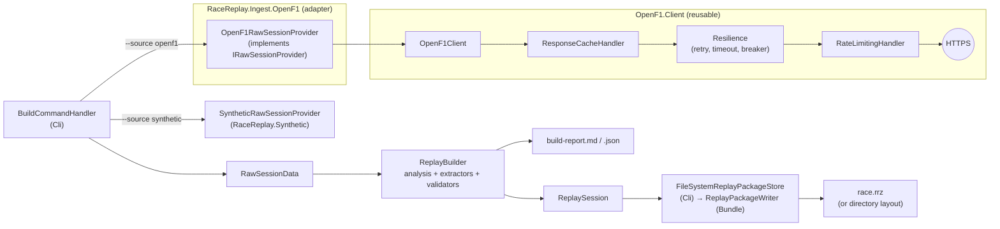

# 04 — Data pipeline & bundle format

This document covers:

- **Build time:** fetching data from OpenF1 (or generating a synthetic race), running the build, and the CLI.
- **The contract with the browser:** the replay bundle format and the single-file replay package.

## 1. Overview



## 2. OpenF1 endpoints used

OpenF1 serves free historical data, from the 2023 season onward, without authentication, as JSON or CSV. Results can be filtered by most attributes, including time ranges such as `date>…&date<…`. Values below were checked in October 2026.

| Endpoint | Purpose in Race Replay | Fields read | Notes |
|---|---|---|---|
| `sessions` | Session metadata, catalogue listing | `session_key`, `session_name`, `session_type`, `circuit_key`, `circuit_short_name`, `country_name`, `date_start`, `date_end`, `year`, `meeting_key`, `is_cancelled` | Updated daily at midnight UTC |
| `meetings` | Grand Prix name | `meeting_name`, `meeting_key`, `circuit_key` | |
| `drivers` | Names, team, colour per session | `driver_number`, `name_acronym`, `full_name`, `broadcast_name`, `team_name`, `team_colour` | `country_code` is deprecated and not read |
| `location` | Car positions | `date`, `driver_number`, `x`, `y`, `z` | About 3.8–3.9 Hz on a common clock (Δt p50 0.24 s), with no gaps over 2 s while a car runs; timestamps jitter. `(0,0,0)` only before a car runs, after it stops, and for non-starters (S1). Approximate. Arbitrary origin. No lateral detail. |
| `laps` | Lap anchors, reference laps | `driver_number`, `lap_number`, `date_start`, `lap_duration`, `is_pit_out_lap` | `date_start` is approximate. Mini-sector segments are not available in races. |
| `pit` | Pit events, pit windows | `date`, `driver_number`, `lap_number`, `lane_duration`, `stop_duration` | `pit_duration` is deprecated (removed after 2026). `stop_duration` exists from the 2024 US GP onwards. `date` marks the pit-lane exit (S1). Cars waiting in the pit lane during a red flag get records too. |
| `race_control` | Flags, safety car, suspensions, session status | `date`, `category`, `flag`, `scope`, `lap_number`, `driver_number`, `message` | `SessionStatus` messages (`SESSION STARTED`, `SESSION ABORTED`, `SESSION FINISHED`) mark the start, suspensions and finish. Exact wording in [S1](spikes/S1.md#race_control-wording). |
| `session_result` | Classification, laps completed, DNF | `driver_number`, `position`, `number_of_laps`, `dnf`, `dns`, `dsq` | Available minutes after official results |
| `intervals` | **Validation only** (gap accuracy) | `date`, `driver_number`, `gap_to_leader`, `interval` | About 4 s updates, races only. Values are a number, `"+N LAP(S)"`, or `null`. |
| `position` | **Validation only** (running order) | `date`, `driver_number`, `position` | Initial placement plus each subsequent change, not periodic samples |

**Not used in MVP:** `car_data`, `team_radio`, `weather`, `overtakes`, `starting_grid`, `stints` (backlog: tyre overlay), and the championship endpoints.

## 3. Ingest adapter

The OpenF1 code is split in two:

- **`OpenF1.Client`** is reusable and knows nothing about Race Replay. It holds the DTOs, the source-generated JSON context, the `GapValue` converter, the response cache, rate limiting and the resilience configuration. It also covers the endpoints racesim's calibration needs (`stints`, `weather`), so it can be shared without changes (racesim ADR-0009 Part 2; [07 §9.3](07-repository-ci-and-delivery.md#93-packages-and-the-shared-openf1-client)).
- **`RaceReplay.Ingest.OpenF1`** is the adapter. It maps the client's DTOs to domain records and implements `IRawSessionProvider` and `ISessionCatalogSource`.

Until the sharing decision is made, both live in this repository, and `OpenF1.Client` is built but not published.

### 3.1 HTTP pipeline

The typed client is registered with `IHttpClientFactory`. Handlers run outermost first:

1. **`ResponseCacheHandler`**. Returns cached bodies without touching the network, so cache hits never consume rate-limit permits.
2. **Standard resilience handler** (`Microsoft.Extensions.Http.Resilience`). Total and attempt timeouts, retries with exponential backoff and jitter on transient errors and 429 (honouring `Retry-After`), and a circuit breaker.
3. **`RateLimitingHandler`**. Every attempt, including retries, waits for a permit.
4. **Primary handler** (`SocketsHttpHandler`, HTTP/2 enabled, automatic decompression).

```csharp
// OpenF1.Client: reusable registration (no Race Replay types)
public static IServiceCollection AddOpenF1Client(this IServiceCollection services, IConfiguration config)
{
    services.AddOptions<OpenF1Options>().Bind(config.GetSection("OpenF1")).ValidateDataAnnotations().ValidateOnStart();
    services.AddSingleton(sp => CreateOpenF1Limiter(sp.GetRequiredService<IOptions<OpenF1Options>>().Value));
    services.AddTransient<ResponseCacheHandler>();
    services.AddTransient<RateLimitingHandler>();

    IHttpClientBuilder http = services.AddHttpClient<OpenF1Client>(
        c => c.BaseAddress = new Uri("https://api.openf1.org/v1/"));
    http.AddHttpMessageHandler<ResponseCacheHandler>();              // 1. outermost
    http.AddStandardResilienceHandler(o =>                           // 2.
    {
        o.AttemptTimeout.Timeout = TimeSpan.FromSeconds(60);         // large location responses
        o.TotalRequestTimeout.Timeout = TimeSpan.FromMinutes(5);
        o.CircuitBreaker.SamplingDuration = TimeSpan.FromMinutes(2); // must be ≥ 2 × attempt timeout
    });
    http.AddHttpMessageHandler<RateLimitingHandler>();               // 3. innermost: every attempt is limited

    return services;
}

// RaceReplay.Ingest.OpenF1: the adapter on top of the client
public static IServiceCollection AddOpenF1Ingest(this IServiceCollection services, IConfiguration config) =>
    services
        .AddOpenF1Client(config)
        .AddKeyedTransient<IRawSessionProvider, OpenF1RawSessionProvider>("openf1")  // DTO → domain
        .AddTransient<ISessionCatalogSource, OpenF1SessionCatalog>();
```

### 3.2 Rate limiting

The free tier allows **3 requests per second and 30 per minute** (the sponsor tier doubles both). Both limits are enforced by chaining two sliding-window limiters from `System.Threading.RateLimiting`:

```csharp
public sealed class RateLimitingHandler(PartitionedRateLimiter<HttpRequestMessage> limiter) : DelegatingHandler
{
    protected override async Task<HttpResponseMessage> SendAsync(HttpRequestMessage request, CancellationToken ct)
    {
        using RateLimitLease lease = await limiter.AcquireAsync(request, permitCount: 1, ct);
        if (!lease.IsAcquired)
            throw new InvalidOperationException("Rate limiter rejected the request (queue full).");
        return await base.SendAsync(request, ct);
    }
}

static PartitionedRateLimiter<HttpRequestMessage> CreateOpenF1Limiter(OpenF1Options o) =>
    PartitionedRateLimiter.CreateChained(
        PartitionedRateLimiter.Create<HttpRequestMessage, string>(_ =>
            RateLimitPartition.GetSlidingWindowLimiter("per-second", _ => new()
            {
                PermitLimit = o.RequestsPerSecond,          // 3
                Window = TimeSpan.FromSeconds(1),
                SegmentsPerWindow = 4,
                QueueLimit = int.MaxValue,
                QueueProcessingOrder = QueueProcessingOrder.OldestFirst
            })),
        PartitionedRateLimiter.Create<HttpRequestMessage, string>(_ =>
            RateLimitPartition.GetSlidingWindowLimiter("per-minute", _ => new()
            {
                PermitLimit = o.RequestsPerMinute,          // 30
                Window = TimeSpan.FromMinutes(1),
                SegmentsPerWindow = 6,
                QueueLimit = int.MaxValue,
                QueueProcessingOrder = QueueProcessingOrder.OldestFirst
            })));
```

Limits are configuration (`OpenF1:RequestsPerSecond`, `OpenF1:RequestsPerMinute`), so a sponsor-tier key or a future policy change needs no code change. The limiters use the default system clock. Tests exercise the handler with tiny windows, and assert ordering rather than wall-clock timing.

**`429` still happens.** In spike S1, 70 requests paced at exactly these limits drew two `429 Too Many Requests` responses, with `Retry-After` of 1 s and 60 s ([S1](spikes/S1.md#response-size-and-time)). The resilience pipeline (§3.1) must therefore treat `429` as transient and wait for `Retry-After` before retrying.

### 3.3 Response cache

- **Key:** SHA-256 of the normalised request URL (path plus query parameters sorted by name).
- **Layout:**
  - `{CacheRoot}/{session_key}/{endpoint}/{hash}.json` holds the body.
  - `{hash}.meta.json` holds the URL, `fetchedUtc`, HTTP status and content length.
- **Cacheability:** only successful responses for sessions that are **historical**, meaning the session ended more than 30 minutes ago (OpenF1's own definition). The check uses `TimeProvider`, so it is testable.
- **Freshness:** cached historical responses never expire. `--refresh` bypasses and overwrites them, for example if OpenF1 publishes corrections.
- **CI (hosted mode only):** the cache directory is restored and saved with `actions/cache` ([07 §6.5](07-repository-ci-and-delivery.md#65-build-bundlesyml-hosted-mode-only)). GitHub gives each repository 10 GB of cache and evicts entries unused for 7 days, so CI treats the cache as opportunistic. A cold cache costs about a minute of rate-limited fetching per race. Users' local caches persist until deleted.
- The cache stores **raw** OpenF1 responses. It is never published, and stays local or in the CI cache, consistent with the data licence.

### 3.4 JSON handling

- **DTOs** are public `sealed record`s in `OpenF1.Client` that mirror the API exactly. They are the client's public surface, but they never pass the adapter: `RaceReplay.Ingest.OpenF1` maps them to domain records, and the architecture tests stop Application and Domain from referencing `OpenF1.Client`.
- **System.Text.Json source generation**, with snake_case mapping handled by policy rather than attributes:

```csharp
[JsonSourceGenerationOptions(PropertyNamingPolicy = JsonKnownNamingPolicy.SnakeCaseLower,
                             NumberHandling = JsonNumberHandling.AllowReadingFromString)]
[JsonSerializable(typeof(LocationDto))]
[JsonSerializable(typeof(LapDto[]))]
[JsonSerializable(typeof(PitDto[]))]
[JsonSerializable(typeof(IntervalDto[]))]
// … one entry per endpoint
public sealed partial class OpenF1JsonContext : JsonSerializerContext;
```

- **Streaming:** location responses can be several megabytes per driver, so they are streamed rather than buffered:

```csharp
await using Stream body = await response.Content.ReadAsStreamAsync(ct);
await foreach (LocationDto? dto in JsonSerializer.DeserializeAsyncEnumerable(
                   body, OpenF1JsonContext.Default.LocationDto, ct))
{
    if (dto is not null) yield return dto.ToDomain();
}
```

- **Mixed-type values:** `gap_to_leader` and `interval` can be a number, a string such as `"+1 LAP"` / `"+2 LAPS"`, or `null`. A custom `JsonConverter<GapValue>` maps these onto `GapValue` ([03 §2.1](03-domain-and-algorithms.md#21-value-objects)). Unknown strings map to `GapValue.None` and are counted in the diagnostics. They never throw.

## 4. Request plan

For a typical race session:

| Request | Calls | Typical payload |
|---|---|---|
| `sessions?session_key=…` | 1 | < 1 KB |
| `meetings?meeting_key=…` | 1 | < 1 KB |
| `drivers?session_key=…` | 1 | ~5 KB |
| `session_result?session_key=…` | 1 | ~3 KB |
| `laps?session_key=…` | 1 | ~600 KB |
| `pit?session_key=…` | 1 | ~5 KB |
| `race_control?session_key=…` | 1 | ~30 KB |
| `intervals?session_key=…` | 1 | ~2 MB |
| `position?session_key=…` | 1 | ~100 KB |
| `location?session_key=…&driver_number=N` | 20 (one per driver) | ~4–6 MB each, 2–5 s (S1) |
| **Total** | **≈ 29** | **≈ 90–125 MB** |

At 30 requests per minute this takes **about one minute** of rate-limited time, plus transfer time.

**Adaptive windowing.** If a per-driver location request times out or fails with a non-transient error, the loader bisects the time range (`date>` / `date<`) and retries each half, recursing down to `MinLocationWindow` (default 5 minutes). Windows are concatenated and de-duplicated. The worst case (every driver split into 5-minute windows) is about 600 requests, or 20 minutes. This is still bounded, and the cache makes it a one-off.

## 5. Build orchestration

`BuildCommandHandler` (Cli) and `ReplayBuilder` (Application) run these steps:

1. **Load** (handler): resolve the keyed `IRawSessionProvider` for `--source` and call `LoadAsync`. The OpenF1 provider fails fast with a `DataException` if the session is not a race, is cancelled, or has no location data.
2. **Analyse** (builder): `SessionAnalyzer` runs clean → centreline → project → progress (gate + envelope) → resample → gaps.
3. **Extract events** (builder): run every `IEventExtractor`. Merge results and sort by time.
4. **Assemble** (builder): create the `ReplaySession`, with provenance:
   - `source`: `openf1` or `synthetic`;
   - licence;
   - retrieval time (from `TimeProvider`);
   - builder version;
   - parameters;
   - for synthetic races, the seed.
5. **Validate** (builder): run every `IReplayValidator`. Results go into the report. For synthetic races, the generator also emits interval and position records computed from its exact ground truth, so the same gap and order validators run. This is how the analysis is regression-tested end to end ([§11](#11-synthetic-races)).
6. **Persist** (handler): `IReplayPackageStore.SaveAsync` writes a `.rrz` package (default) or the directory layout (`--layout directory`, for hosted mode), plus the report.

### Build report

Written as both Markdown (for humans and the CI job summary) and JSON (for tooling):

- Session summary: name, date, laps, drivers, duration.
- Per-driver data quality: raw samples, dropped (placeholder / spike / duplicate), splits, valid coverage %, maximum lateral error, off-centreline count.
- Track: lap length (track units and metres), reference laps used, start/finish confidence.
- Events: counts by type.
- Validation: pass/warn/fail per validator, plus the gap-accuracy table (median, P95, max per driver) and the running-order agreement table.
- Plausibility: rejected forward steps and unconfirmed re-acquisitions per driver.
- Output: file sizes against the NFR-04 budget, and SHA-256 hashes.

## 6. CLI

`RaceReplay.Cli` is a .NET 10 console app using the Generic Host (DI, config, logging) and **System.CommandLine 2.0** (stable since November 2025).

| Command | Purpose |
|---|---|
| `race-replay sessions --year 2025 [--type Race]` | List OpenF1 sessions and their keys |
| `race-replay build --session 9839 [--out replays] [--hz 4] [--cache .cache/openf1] [--refresh] [--report out/report.md]` | Build a real race as `replays/2025-9839.rrz` (OpenF1 is the default source) |
| `race-replay build --source synthetic --seed 7 [--out replays]` | Generate and build a synthetic race through the same pipeline |
| `race-replay build … --layout directory` | Write the directory layout instead of a package (hosted mode and demo races) |
| `race-replay validate <package-or-dir> [--strict]` | Re-run validators (against cached OpenF1 data for real races) and verify SHA-256 hashes. With `--strict`, warnings fail. |
| `race-replay inspect <package-or-dir>` | Print the manifest summary, binary headers and channel statistics |
| `race-replay catalog --bundles <dir> [--mode demo\|hosted] [--out <dir>/catalog.json]` | Regenerate a catalogue from bundle manifests. `--mode` records whether the site serves demo races only or hosted real races too (§8). |
| `race-replay schema [--out docs/schema]` | Write the JSON Schemas for `manifest.json` and `catalog.json` (§10) |

| Exit code | Meaning |
|---|---|
| 0 | Success |
| 1 | Unexpected error (bug, I/O failure) |
| 2 | Invalid usage (System.CommandLine parse error) |
| 3 | Data error: session not found, not a race, or insufficient data |
| 4 | Validation failed (`validate --strict`, or a build with failing validators) |
| 130 | Cancelled (Ctrl+C), the shared convention with racesim |

```csharp
// Program.cs (abridged)
var builder = Host.CreateApplicationBuilder(args);
builder.Services
    .AddReplayAnalysis(builder.Configuration)     // SessionAnalyzer + steps + options
    .AddReplayApplication()                       // ReplayBuilder, extractors, validators
    .AddOpenF1Ingest(builder.Configuration)       // keyed IRawSessionProvider "openf1" + catalogue
    .AddSyntheticRaces(builder.Configuration)     // keyed IRawSessionProvider "synthetic"
    .AddReplayPackages();                         // FileSystemReplayPackageStore, report writer
using IHost host = builder.Build();

var sourceOption = new Option<string>("--source") { Description = "openf1 | synthetic", DefaultValueFactory = _ => "openf1" };
sourceOption.AcceptOnlyFromAmong("openf1", "synthetic");
var sessionOption = new Option<int?>("--session") { Description = "OpenF1 session key" };
var seedOption = new Option<int?>("--seed") { Description = "Seed for a synthetic race" };
var layoutOption = new Option<PackageLayout>("--layout") { DefaultValueFactory = _ => PackageLayout.Package };

var build = new Command("build", "Build a replay") { sourceOption, sessionOption, seedOption, layoutOption };
build.Validators.Add(r =>
{
    if (r.GetValue(sourceOption) == "openf1" && r.GetValue(sessionOption) is null) r.AddError("--session is required for openf1.");
    if (r.GetValue(sourceOption) == "synthetic" && r.GetValue(seedOption) is null) r.AddError("--seed is required for synthetic.");
});
build.SetAction((parse, ct) =>
{
    string source = parse.GetValue(sourceOption)!;
    SessionKey key = source == "synthetic"
        ? SessionKey.Synthetic(parse.GetValue(seedOption)!.Value)
        : new SessionKey(parse.GetValue(sessionOption)!.Value);
    return host.Services.GetRequiredService<BuildCommandHandler>()
        .RunAsync(source, key, parse.GetValue(layoutOption), ct);
});

var root = new RootCommand("Race Replay tooling") { build /*, sessions, validate, inspect, catalog */ };
return await root.Parse(args).InvokeAsync();
```

Command handlers are ordinary classes resolved from DI, each with a single `RunAsync` method. This keeps System.CommandLine at the edge, and lets handlers be unit-tested without parsing.

## 7. Bundle format (schema 1.0)

### 7.1 Layouts

A bundle is always the same three logical files. They are stored in one of two layouts.

**Package (default)**: one file the user opens in the app (ADR-0008):

```text
2025-9839.rrz          # ZIP archive, entries stored uncompressed by default
├─ manifest.json       # metadata, track, drivers, events, channel index (JSON)
├─ positions.rrb       # x, y, progress, validity per car (binary)
├─ gaps.rrb            # gap-to-leader per car (binary)
└─ DATA-NOTICE.txt     # attribution and licence (real races) or "synthetic data" notice
```

**Directory**: served as static files, for demo races and hosted mode:

```text
bundles/
├─ catalog.json
├─ demo/{id}/                 # synthetic demo races (public site)
│  ├─ manifest.json
│  ├─ positions.rrb
│  └─ gaps.rrb
└─ {year}/{session_key}/      # real races, hosted mode only
   └─ …same three files
```

**Package rules**

- Entries are read with `System.IO.Compression.ZipArchive` from an in-memory stream, which works in the browser.
- Only the four entry names above are accepted. Any other entry, path separator or `..` causes rejection, so there is no path traversal.
- Each entry's uncompressed size is capped (16 MB).
- Entries are *stored* (uncompressed) by default, so reading needs no inflate step. Spike S2 checks whether deflate compression is worth enabling for packages people share.

### 7.2 `manifest.json`

Values below are illustrative.

```json
{
  "format": "race-replay-bundle",
  "schemaVersion": "1.0",
  "$schema": "https://OWNER.github.io/race-replay/schema/bundle-manifest-1.0.schema.json",
  "session": {
    "key": 9839, "year": 2025, "type": "Race", "name": "Race",
    "meetingName": "Abu Dhabi Grand Prix", "circuit": "Yas Marina Circuit",
    "circuitKey": 70, "startUtc": "2025-12-07T13:00:00Z"
  },
  "timeline": {
    "t0Utc": "2025-12-07T12:39:12Z", "sampleRateHz": 4, "sampleCount": 31840, "raceStart": 1248.75,
    "segments": [
      { "start": 0, "end": 1248.75, "kind": "preRace" },
      { "start": 1248.75, "end": 6981.5, "kind": "racing" },
      { "start": 6981.5, "end": 7959.75, "kind": "postRace" }
    ]
  },
  "track": {
    "unitsPerMetre": 10, "lapLength": 52810.4, "displayRotationDegrees": -12.5,
    "bounds": { "minX": -8650, "minY": -4020, "maxX": 7710, "maxY": 5480 },
    "centreline": [[-1203.5, 512.0], [-1180.2, 515.9]]
  },
  "drivers": [
    { "index": 0, "number": 1, "acronym": "VER", "fullName": "Max VERSTAPPEN",
      "team": "Red Bull Racing", "colour": "3671C6", "status": "finished", "finalPosition": 1 }
  ],
  "events": [
    { "type": "pitStop", "time": 2873.25, "driver": 4, "lap": 23, "laneDuration": 21.9, "stopDuration": 2.4 },
    { "type": "trackStatus", "time": 3410.0, "endTime": 3655.5, "status": "virtualSafetyCar" },
    { "type": "chequeredFlag", "time": 6981.5 }
  ],
  "channels": {
    "positions": { "file": "positions.rrb", "bytes": 4612352, "sha256": "…" },
    "gaps": { "file": "gaps.rrb", "bytes": 581760, "sha256": "…", "sampleRateHz": 1 }
  },
  "provenance": {
    "source": "openf1", "attribution": "Data: OpenF1 — https://openf1.org", "licence": "CC BY-NC-SA 4.0",
    "retrievedUtc": "2025-12-08T09:14:03Z", "builder": "race-replay 0.6.0+3f2c1ab",
    "parameters": { "timelineHz": 4, "gapHz": 1, "centrelineSpacingMetres": 5 }
  }
}
```

- Serialised with a source-generated `JsonSerializerContext`, using camelCase and invariant culture.
- Manifest DTOs live in the Bundle project and are mapped to domain types. The domain carries no serialisation attributes.
- Events use System.Text.Json polymorphism (`[JsonPolymorphic(TypeDiscriminatorPropertyName = "type")]` plus `[JsonDerivedType]`), which source generation supports. Unknown `type` values are skipped by the reader, so newer bundles degrade gracefully in older clients.

### 7.3 Binary container (`.rrb`)

All integers and floats are **little-endian**. Channel blocks start on 8-byte boundaries.

**Header (64 bytes)**

| Offset | Size | Type | Field |
|---|---|---|---|
| 0 | 4 | ASCII | Magic `RRB1` |
| 4 | 2 | u16 | Format major (1) |
| 6 | 2 | u16 | Format minor (0) |
| 8 | 2 | u16 | Kind: 1 = positions, 2 = gaps |
| 10 | 2 | u16 | Car count |
| 12 | 4 | u32 | Sample count (per channel) |
| 16 | 8 | f64 | Sample rate (Hz) |
| 24 | 4 | f32 | Quantisation scale |
| 28 | 4 | f32 | Quantisation origin X |
| 32 | 4 | f32 | Quantisation origin Y |
| 36 | 4 | u32 | Flags (bit 0: delta-encoded integer channels; reserved in 1.0) |
| 40 | 4 | u32 | Directory offset |
| 44 | 4 | u32 | Directory entry count |
| 48 | 16 | — | Reserved (zero) |

**Directory entry (16 bytes each)**

| Size | Type | Field |
|---|---|---|
| 2 | u16 | Driver number |
| 2 | u16 | Channel ID: 1 = X, 2 = Y, 3 = Progress, 4 = Validity, 10 = Gap |
| 2 | u16 | Encoding: 1 = Int16 quantised, 2 = Float32, 3 = Bitmap |
| 2 | u16 | Reserved |
| 4 | u32 | Block offset |
| 4 | u32 | Block length (bytes) |

**Encodings**

- **Int16 quantised** (X, Y): `q = clamp(round((v − origin) / scale), −32767, 32767)` and `v = origin + q × scale`. `scale = max(rangeX, rangeY) / 65000`, which gives sub-decimetre precision for any circuit. Ranges come from exact min/max. Rounding uses `MidpointRounding.ToEven`. That makes rebuilds byte-identical on the same platform and SDK (NFR-11).
- **Float32** (progress, gaps): IEEE 754 single precision. Gaps use `NaN` for "undefined". Progress in track units fits float32 comfortably: about 3,000,000 dm for a race, with roughly 0.25 dm resolution at the end.
- **Bitmap** (validity): bit *k* of the block is grid point *k*, LSB first.

**Why structure-of-arrays.** Each channel is a contiguous primitive array. That gives the client:

- **zero-copy views** via `MemoryMarshal.Cast<byte, short>` / `Cast<byte, float>`;
- good compression, because neighbouring values are similar;
- the option to add channels (for example tyre compound) without changing existing ones.

### 7.4 Size budget (2-hour race, 20 cars)

| Part | Calculation | Size |
|---|---|---|
| X + Y | 20 × 28,800 × 2 × 2 B | 2.30 MB |
| Progress | 20 × 28,800 × 4 B | 2.30 MB |
| Validity | 20 × 28,800 / 8 | 0.07 MB |
| Gaps | 20 × 7,200 × 4 B | 0.58 MB |
| Manifest | ~1,000 centreline points + events | ~0.06 MB |
| **Total** | | **≈ 5.3 MB** (NFR-04: ≤ 6 MB) |

Over the wire, gzip should roughly halve this. Delta-encoding integer channels (flag bit 0, planned as schema 1.1) is expected to improve that further. Spike S2 measures both.

### 7.5 Reading a bundle

```csharp
public static class ReplayPackageReader
{
    // .rrz: open from an in-memory stream (browser) and hand the entries to the bundle reader.
    public static ReplaySession ReadPackage(Stream package)
    {
        using var zip = new ZipArchive(package, ZipArchiveMode.Read);
        PackageEntries entries = PackageEntries.FromArchive(zip);     // allow-listed names, size caps
        return ReplayBundleReader.Read(entries.Manifest, entries.Positions /*, entries.Gaps */);
    }
}

// Stateless, so a static class rather than a DI service.
public static class ReplayBundleReader
{
    public static ReplaySession Read(ReadOnlySpan<byte> manifestJson, ReadOnlySpan<byte> positions)
    {
        RrbHeader header = RrbHeader.Parse(positions, RrbKind.Positions);  // validates magic, version, bounds
        // …directory lookup per driver/channel, bounds-checked, then dequantise each block once into a float[]
        // owned by CarChannels (amortised at load; sampling stays branch-light).
    }
}
```

The reader treats bundle and package bytes as **untrusted input**. This matters more now that users open files from anywhere.

- Package entries are allow-listed by name, with size caps.
- Every offset and length is bounds-checked against the buffer.
- Counts are capped (≤ 40 cars, ≤ 2,000,000 samples).
- Version mismatches produce a typed `BundleFormatException`, which the UI shows as "this replay needs a newer version of the app".

The CLI `validate` command verifies SHA-256 hashes. The browser checks lengths against the manifest.

## 8. Catalogue

`bundles/catalog.json` lists the replays served with the site. On the public site that means synthetic demo races only. In hosted mode, real races are listed too.

```json
{
  "schemaVersion": "1.0",
  "generatedUtc": "2026-10-12T08:00:00Z",
  "mode": "demo",
  "sessions": [
    { "id": "demo-1", "source": "synthetic", "title": "Demo GP — Kestrel Park (seed 1)",
      "laps": 52, "path": "demo/1/", "bundleSchema": "1.0", "bytes": 4810000 },
    { "id": "2025-9839", "source": "openf1", "title": "2025 Abu Dhabi Grand Prix — Race",
      "year": 2025, "key": 9839, "path": "2025/9839/", "bundleSchema": "1.0", "bytes": 5321000 }
  ]
}
```

The second entry only appears in hosted mode, where `mode` is `"hosted"`.

- **`mode` lives in the catalogue, not in the app's settings.** On GitHub Pages the deploy step must not edit published app files, because Blazor checks the integrity of what it loads. The catalogue is data the app fetches, so `assemble-site.sh` regenerates it freely ([07 §6.3](07-repository-ci-and-delivery.md#63-deploy-pagesyml-and-scriptsassemble-sitesh)).
- Because the client follows only `path` values from the catalogue, bundles could move to other static storage (for example object storage plus a CDN) by changing the catalogue. No client change is needed.
- Local packages never appear in the catalogue. They are opened directly ([05 §9](05-web-client.md#9-loading-and-errors)).

## 9. Compression and hosting (spike S2)

This applies to bundles **served by the site**: demo races, and real races in hosted mode. Local packages are read from disk, where size matters much less. GitHub Pages serves static files. Spike S2 decides between these options by measuring transfer size, load time and code complexity:

| Option | How | Trade-off |
|---|---|---|
| **A. Raw files** | Publish `.rrb` as-is and rely on any transparent compression by the host | Simplest. S2 checks whether Pages compresses `application/octet-stream` responses. |
| **B. Pre-gzipped files** | Publish `.rrb.gz`. The client decompresses with `GZipStream` in .NET (if supported in browser-wasm) or the browser's `DecompressionStream("gzip")` via a tiny JS helper. | Predictable size. Small decompression cost (~50 ms). |
| **C. Delta + gzip** | As B, plus delta-encoded integer channels (schema 1.1) | Smallest. Slightly more reader code. |

The default plan is **B**, upgraded to **C** if S2 shows a meaningful gain. S2 also confirms that `InputFile` and `ZipArchive` behave well in browser-wasm for 5–10 MB packages. Whatever S2 decides is recorded in ADR-0004 as an addendum.

## 10. Versioning and compatibility

- `schemaVersion` follows *major.minor*.
  - Additive changes (new optional manifest fields, new channels, new event types) bump the **minor** version. Readers ignore what they don't know.
  - Breaking changes bump the **major** version. The reader rejects unknown majors with a clear message. For a local package, the message also says "rebuild it with the current CLI".
- Bundles are **derived artifacts**. On a major bump, demo races and hosted bundles are rebuilt by the workflows. Users rebuild their own packages. No migration code is kept.
- **Machine-checkable contract.** The manifest and catalogue DTOs are the source of truth. `race-replay schema` generates JSON Schemas from them with `JsonSchemaExporter` (System.Text.Json, .NET 9+):

  ```csharp
  JsonNode manifestSchema = JsonSchemaExporter.GetJsonSchemaAsNode(
      BundleJsonContext.Default.BundleManifestDto,
      new JsonSchemaExporterOptions { TreatNullObliviousAsNonNullable = true });
  ```

  - The schemas are committed under `docs/schema/` and published with the site, so manifests can reference them via `$schema` and editors validate them.
  - A golden test fails if the generated schema differs from the committed one. A format change therefore always shows up as a reviewed schema diff, alongside a `schemaVersion` bump.
- Golden-file tests pin the exact bytes of a small synthetic bundle, so accidental format changes fail CI ([06 §7](06-testing-strategy.md#7-golden-file-and-determinism-tests)).

## 11. Synthetic races

`RaceReplay.Synthetic` is a production adapter, not a test helper. It implements `IRawSessionProvider` under the key `"synthetic"`. It produces `RawSessionData` that looks like what OpenF1 returns, so everything downstream runs the same code (FR-17, ADR-0008).

### 11.1 Uses

| Use | How |
|---|---|
| Public demo races | CI builds the seeds listed in `config/demo-races.json` with `--layout directory` and deploys them with the app |
| UI development before ingest exists | `race-replay build --source synthetic --seed 1`, then open the package |
| End-to-end and component tests | Stable, licence-free inputs |
| Algorithm regression | The generator knows the exact ground truth, so the derived progress, gaps and order are checked against it, not against another estimate |

### 11.2 Generation

1. **Circuit.**
   - Place seeded control points around a perturbed loop and join them with a closed centripetal Catmull-Rom spline.
   - Reject self-intersecting layouts, except for an optional figure-eight variant that tests crossover handling.
   - Scale to a target lap length (4.5–6 km).
   - Add a pit lane offset alongside the start straight.
   - Give it a generated fictional name (for example "Kestrel Park").
2. **Field.**
   - Twenty fictional drivers with generated names and three-letter acronyms.
   - Ten fictional teams with a generated, contrast-checked colour palette.
   - No real names, liveries or marks.
3. **Race model.** Deliberately simple, but enough to exercise every feature:
   - per-driver base pace plus lap-to-lap noise;
   - linear tyre degradation per stint;
   - one or two pit stops, with lane time;
   - a seeded safety car / virtual safety car hazard per lap;
   - a seeded retirement chance;
   - a "can't pass within *x* s unless the pace delta exceeds *y*" rule, so battles and DRS-style trains form.

   Overtakes, lapping and gap changes emerge from these rules.
4. **Ground truth.** Exact progress, positions, order and gaps at a fine time step. From these, the generator derives the `laps`, `pit`, `race_control` (using the same message wording as real data, confirmed in spike S1), `session_result`, `intervals` and `position` records.
5. **Observation model.** Sample (x, y) at about 3.7 Hz with per-car phase offsets and Gaussian jitter. Then inject the faults real data has — dropouts, spikes, zero placeholders, forward snaps — at rates set by a profile:
   - `Clean` for unit tests;
   - `Realistic` for demos;
   - `Harsh` for regression.

### 11.3 Determinism

- **Own random generator.** The generator uses its own xoshiro256\*\* implementation, seeded per race and per channel (track, field, race, noise). It does not use `System.Random`, whose algorithm is not guaranteed stable across .NET versions. This is the same choice the racesim project made, and the implementation can be shared later.
- **Reproducibility.** Seed plus generator version produces identical `RawSessionData`.
- **Reserved keys.** Synthetic races use `SessionKey.Synthetic(seed)`, a reserved range far above OpenF1's keys. Each provider rejects keys outside its own range (the contract clause in [02 §7](02-architecture.md#7-key-abstractions)).
- **Labelling.** The UI labels synthetic races clearly as "Synthetic demo — fictional data".
