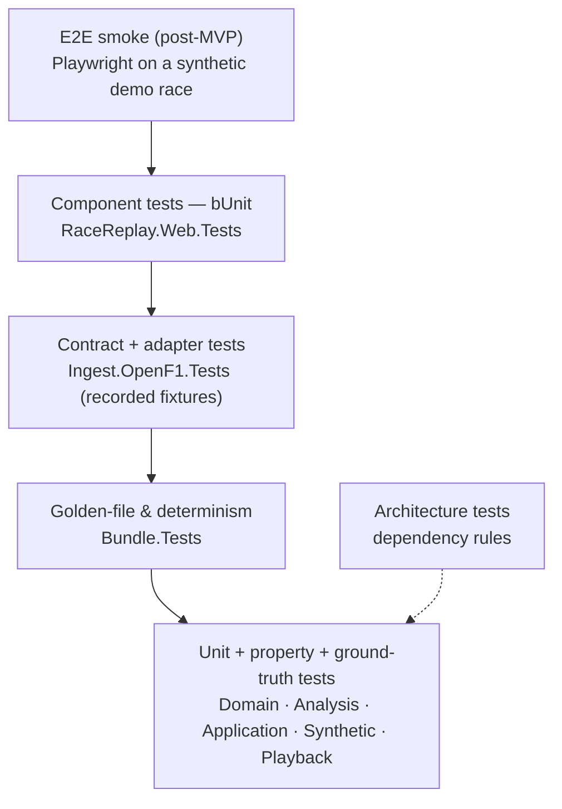

# 06 — Testing strategy

## 1. Principles

1. **Test the core hard, the edges lightly.** Domain, Analysis, Bundle and Playback hold almost all the logic. They are pure and deterministic, and get dense unit tests. Adapters (HTTP, JS) get focused tests around their contracts.
2. **No network, no wall clock, no randomness without a seed.**
   - The network is replaced by recorded fixtures.
   - Time comes from `FakeTimeProvider` or from explicit timestamps.
   - Random data uses fixed seeds.
3. **Synthetic worlds with known answers.** Instead of asserting "about what we got last time", algorithm tests use synthetic races whose correct gaps, laps and order are known exactly:
   - analytic cases, calculable by hand;
   - full generated races, where the generator's ground truth gives the answer.
4. **Contracts over mocks.** Port behaviour is specified once as an abstract test class. It runs against every implementation, and the synthetic data source is one of them.
5. **Test pure code directly.** Concrete, deterministic classes are tested as they are, with no interface and no mock (ADR-0009). Substitutes are used only at real seams: ports, the JS boundary, and the file system.

## 2. Tooling

| Tool | Version (Oct 2026) | Role |
|---|---|---|
| **xUnit.net v3** (`xunit.v3`) | 4.0.x | Test framework. Since 4.0 it installs `xunit.v3.mtp-v2`, i.e. Microsoft Testing Platform v2, by default. |
| **Microsoft Testing Platform (MTP) v2** | via xUnit | Test host. Native `dotnet test` integration in the .NET 10 SDK. |
| `Microsoft.Testing.Extensions.CodeCoverage` | latest | `--coverage` with Cobertura output |
| `Microsoft.Extensions.TimeProvider.Testing` | 10.0.x | `FakeTimeProvider` |
| **CsCheck** | latest | Property-based tests. Framework-agnostic, so not coupled to xUnit versions. |
| **bUnit** | 2.x | Blazor component tests (from M5). Check compatibility with xUnit 4 when added. |
| NSubstitute | latest (optional) | Only where a hand-written fake would be larger than the test |
| xUnit `Assert` | built in | Assertions. FluentAssertions 8+ is commercially licensed, so it is avoided. |

### 2.1 Enabling MTP mode for `dotnet test`

From the .NET 10 SDK, `dotnet test` must be told to use Microsoft Testing Platform via `global.json`. Without it, MTP v2 test projects are rejected.

```json
{
  "sdk": { "version": "10.0.100", "rollForward": "latestFeature" },
  "test": { "runner": "Microsoft.Testing.Platform" }
}
```

### 2.2 Shared test project settings

`tests/Directory.Build.props` comes from the shared template ([07 §2](07-repository-ci-and-delivery.md#2-shared-template)). It imports the root props, then adds test-only settings. Every test `.csproj` stays tiny.

```xml
<Project>
  <Import Project="$([MSBuild]::GetPathOfFileAbove('Directory.Build.props', '$(MSBuildThisFileDirectory)../'))" />
  <PropertyGroup Condition="!$(MSBuildProjectName.EndsWith('.TestKit'))">
    <OutputType>Exe</OutputType>                       <!-- xUnit v3 test projects are executables -->
    <IsPackable>false</IsPackable>
    <IsTestProject>true</IsTestProject>
  </PropertyGroup>
  <ItemGroup Condition="'$(IsTestProject)' == 'true'">
    <PackageReference Include="xunit.v3" />
    <PackageReference Include="Microsoft.Testing.Extensions.CodeCoverage" />
    <Using Include="Xunit" />
  </ItemGroup>
</Project>
```

```xml
<!-- tests/RaceReplay.Analysis.Tests/RaceReplay.Analysis.Tests.csproj -->
<Project Sdk="Microsoft.NET.Sdk">
  <ItemGroup>
    <ProjectReference Include="..\..\src\RaceReplay.Analysis\RaceReplay.Analysis.csproj" />
    <ProjectReference Include="..\RaceReplay.TestKit\RaceReplay.TestKit.csproj" />
  </ItemGroup>
</Project>
```

### 2.3 Running tests

```bash
dotnet test                                                    # whole solution (RaceReplay.slnx)
dotnet test --project tests/RaceReplay.Analysis.Tests          # one project
dotnet test --filter-class "*GapCalculatorTests"               # xUnit MTP filter options
dotnet test --coverage --coverage-output-format cobertura --report-xunit-trx   # CI
```

**Where tests run.** CI runs the whole suite on `ubuntu-latest`, `windows-latest` and `macos-latest`, because users run the CLI on all three (ADR-0008, [07 §6.2](07-repository-ci-and-delivery.md#62-ciyml)). Tests are written to pass on all three:

- paths are built with `Path.Combine`;
- temporary directories come from `Path.GetTempPath()`;
- no test depends on line endings or the current culture.

The few tests that pin exact bytes run their exact assertion only on the reference platform (§7).

**Parallelism.** The pure test projects (Domain, Analysis, Bundle, Playback) can opt into xUnit 4's full test parallelisation with `[assembly: Parallelization(Mode = ParallelMode.All)]`. Projects that touch shared resources (file-system cache tests) keep the default, collection-level parallelism.

**Cancellation.** Async tests pass `TestContext.Current.CancellationToken` to the code under test, as the xUnit analyzers recommend, so cancelled runs stop promptly.

## 3. Test pyramid and project map



| Test project | Focus | Approx. share |
|---|---|---|
| `RaceReplay.Domain.Tests` | Value objects, parsing, invariants | 5 % |
| `RaceReplay.Analysis.Tests` | Cleaning, centreline, projection, progress gate, resample, gaps, order; analytic cases, property tests, ground-truth regression on generated races | 30 % |
| `RaceReplay.Application.Tests` | Builder orchestration, extractors, validators, report content | 10 % |
| `RaceReplay.Synthetic.Tests` | Generator determinism, circuit validity, fault-injection rates, provider contract | 5 % |
| `RaceReplay.Bundle.Tests` | Writer/reader and package round-trip, golden files and schema, determinism, malformed-input safety | 15 % |
| `OpenF1.Client.Tests` | URL building, DTO deserialisation, `GapValue` converter, streaming, cache, rate limiting, adaptive windowing | 7 % |
| `RaceReplay.Ingest.OpenF1.Tests` | DTO → domain mapping, provider contract on recorded fixtures | 3 % |
| `RaceReplay.Playback.Tests` | Clock, sampler (including zero-allocation), running order, tower and chart projection | 15 % |
| `RaceReplay.Cli.Tests` | Command handlers with substitute stores and report writers; option validation; exit codes | 5 % |
| `RaceReplay.Web.Tests` (M5) | Components with the real `ReplayStore` and fake renderers; opening packages | 5 % |
| `RaceReplay.Architecture.Tests` | Project dependency rules, banned APIs | — |
| `RaceReplay.TestKit` (library) | Contract base classes, recorded-fixture loader, assertion helpers. References `xunit.v3.extensibility.core` and `xunit.v3.assert` so the abstract contract classes can carry `[Fact]`s. Synthetic builders live in the production `RaceReplay.Synthetic` library and are reused here. | — |

## 4. Conventions

- **Naming:** `Subject_Scenario_Expectation`. For example `Unwrap_ProgressCrossesLine_IncrementsLap` or `Sample_BothNeighboursInvalid_HidesCar`.
- **Structure:** Arrange–Act–Assert, separated by blank lines. One behavioural concept per test.
- **Theories** for tables of cases (`[Theory]` + `[InlineData]` / `TheoryData<…>`).
- **Builders** from `RaceReplay.Synthetic` keep arrange sections short and intention-revealing (`SyntheticSession.Race().WithCars(2).Build()`).
- **Tolerances** are explicit constants with a comment explaining them (for example `const double QuantisationTolerance = 0.5; // scale ≈ 0.3 units`).
- **No logic in tests** beyond what the expectation needs. Expected values are computed from the scenario's parameters, not copied from output.
- **Every bug fix starts with a failing test**, ideally a synthetic reproduction rather than a recorded fixture.

## 5. Synthetic fixtures

`RaceReplay.Synthetic` is the production generator that also builds the demo races ([04 §11](04-data-pipeline-and-bundle-format.md#11-synthetic-races)). It exposes two levels:

- low-level builders for small analytic worlds;
- a full seeded race generator.

Tests use both.

| Builder | Shape | Typical assertions |
|---|---|---|
| `SyntheticTrack.Circle(radiusMetres)` | Circle | Lap length = 2πr ± 0.5 % |
| `SyntheticTrack.Stadium(straight, radius)` | Two straights + two semicircles | Start/finish placement, uniform resampling |
| `SyntheticTrack.FigureEight(size)` | Self-crossing loop | Projection never jumps branch at the crossing |
| `SyntheticTrack.WithParallelPitLane(offsetMetres)` | Stadium plus a parallel pit path | Pit tolerance; no backwards snaps |
| `SyntheticCar.ConstantSpeed(track, speed, startProgress)` | Uniform motion, sampled at about 3.7 Hz with optional jitter | Gaps, ordering, laps |
| `.WithDropout(from, to)` / `.WithSpike(at)` / `.WithZeroPlaceholder(at)` / `.Retires(at)` / `.PitStop(at, duration)` | Fault injection | Cleaning, validity, events |
| `.WithSnapAhead(at, metres)` | One sample placed on a parallel section of track further round the lap. It is plausible as a position, so the cleaner keeps it, but wrong as progress. | Re-acquisition rule, plausibility gate, envelope speed limit |
| `SyntheticSession.Race()` | Composes cars into `RawSessionData` with analytic laps, results and race control | End-to-end build tests |
| `SyntheticRaceGenerator.Generate(seed, FaultProfile.Harsh)` | Full procedural race with incidents, plus exact ground truth | Ground-truth regression (below) |

**Analytic expectations** (*v* = speed, Δ = distance behind, *L* = lap length):

- **Equal speeds.** Car B is Δ behind car A, both at *v*, so `gap_B = Δ / v` exactly, at all times after B passes A's progress at race start.
- **Different speeds.** Leader at *v₂*, follower at *v₁ < v₂*, both from the line at *t = 0*. Then `D*(t) = v₂ t` and `T*(x) = x / v₂`, so `gap₁(t) = t (1 − v₁ / v₂)`, a straight line.
- **Lapping.** After `t = L / (v₂ − v₁)` the follower is exactly one lap down.
- **Pit stop.** A stationary period τ adds exactly τ to the car's gap once it is back up to speed.
- **Forward snap.** Run the same session with and without a `.WithSnapAhead(…)` fault on the leading car. Every car's gap series must be identical within tolerance, and the build report must show exactly one rejected sample. This guards the ratchet behaviour of the envelope ([03 §8.1](03-domain-and-algorithms.md#81-gap-to-the-virtual-leader)).

**Ground-truth regression.** A theory runs a fixed set of seeds through the full analysis with the `Harsh` fault profile and compares the derived results with the generator's exact truth:

- progress error;
- gap error (median and P95);
- running-order agreement.

The thresholds are tighter than NFR-05, because the noise model is known. Any change to the analysis that degrades accuracy shows up here as a failing test, long before it would be noticed on real data.

```csharp
public sealed class GapCalculatorTests
{
    private const double Tolerance = 0.01; // s; resampling at 4 Hz + float32 storage

    [Theory]
    [InlineData(50.0, 100.0)]
    [InlineData(80.0, 40.0)]
    public void Compute_EqualSpeedCars_GapIsDistanceOverSpeed(double speed, double metresBehind)
    {
        var session = SyntheticSession.Race()
            .OnTrack(SyntheticTrack.Circle(radiusMetres: 500))
            .WithCar(1, SyntheticCar.ConstantSpeed(speed, startProgressMetres: 0))
            .WithCar(2, SyntheticCar.ConstantSpeed(speed, startProgressMetres: -metresBehind))
            .Duration(TimeSpan.FromMinutes(5))
            .Build();
        var derived = TestAnalysis.Run(session);
        var calculator = new GapCalculator(Options.Create(new GapOptions { GapHz = 1 }));

        var gaps = calculator.Compute(derived.Cars, derived.Timeline);

        float[] follower = gaps.GapFor(new DriverNumber(2)).ToArray();
        Assert.All(follower.Skip(10).Where(float.IsFinite),
                   g => Assert.Equal(metresBehind / speed, g, Tolerance));
    }
}
```

### Property-based tests (CsCheck)

These are used where invariants matter more than specific values:

- Resampling never produces a valid point between two raw samples further apart than `MaxGap`.
- Unwrapped progress is non-decreasing for any sequence of wrapped *s* values with bounded steps.
- `gap ≥ 0` for every car. The car at the envelope has a gap of exactly 0.
- Quantise → dequantise error ≤ scale / 2 for any value in range.
- The bundle reader never throws anything except `BundleFormatException` for arbitrarily mutated or truncated inputs.

```csharp
[Fact]
public void Unwrap_AnyBoundedWrappedSequence_IsMonotonic()
{
    const double L = 1000;
    Gen.Double[0, 40].Array[2, 500]                           // forward steps up to 40 units
        .Sample(steps =>
        {
            double[] s = Wrap(Cumulate(steps), L);
            double[] d = new ProgressUnwrapper().Unwrap(s, L);
            for (int i = 1; i < d.Length; i++) Assert.True(d[i] >= d[i - 1]);
        });
}
```

## 6. Contract tests

Each port with more than one implementation has an abstract contract class in TestKit. Each implementation's test project derives from it, and xUnit runs the inherited `[Fact]`s.

```csharp
// RaceReplay.TestKit/Contracts/RawSessionProviderContract.cs
public abstract class RawSessionProviderContract
{
    protected abstract IRawSessionProvider CreateSut();
    protected abstract SessionKey KnownSession { get; }
    protected abstract SessionKey ForeignSession { get; }   // a key outside this provider's range

    [Fact]
    public async Task Load_KnownSession_ReturnsStrictlyAscendingUtcSamplesPerDriver()
    {
        RawSessionData raw = await CreateSut().LoadAsync(KnownSession, TestContext.Current.CancellationToken);

        Assert.NotEmpty(raw.Locations);
        foreach (var (driver, samples) in raw.Locations)
        {
            Assert.All(samples, s => Assert.Equal(TimeSpan.Zero, s.Timestamp.Offset));
            Assert.All(samples, s => Assert.Equal(driver, s.Driver));
            Assert.All(samples.Zip(samples.Skip(1)), p => Assert.True(p.Second.Timestamp > p.First.Timestamp));
        }
    }

    [Fact]
    public async Task Load_ForeignSession_ThrowsSessionNotFound() =>
        await Assert.ThrowsAsync<SessionNotFoundException>(
            () => CreateSut().LoadAsync(ForeignSession, TestContext.Current.CancellationToken));

    // … laps ordered, driver numbers unique, colours parse, cancellation honoured
}

// RaceReplay.Ingest.OpenF1.Tests
public sealed class OpenF1ProviderContractTests : RawSessionProviderContract
{
    protected override IRawSessionProvider CreateSut() => OpenF1TestHost.WithRecordedFixtures("race-2025-abu-dhabi-excerpt");
    protected override SessionKey KnownSession => new(9839);
    protected override SessionKey ForeignSession => SessionKey.Synthetic(1);
}

// RaceReplay.Synthetic.Tests: the production synthetic adapter obeys the same contract
public sealed class SyntheticProviderContractTests : RawSessionProviderContract
{
    protected override IRawSessionProvider CreateSut() => new SyntheticRawSessionProvider(/* options */);
    protected override SessionKey KnownSession => SessionKey.Synthetic(7);
    protected override SessionKey ForeignSession => new(9839);
}
```

| Contract | Implementations | Key clauses |
|---|---|---|
| `RawSessionProviderContract` | OpenF1 (recorded fixtures), Synthetic | UTC, strictly ascending per driver; laps ordered by (driver, lap); driver numbers unique; colours parse; foreign keys rejected; cancellation honoured |
| `ReplaySourceContract` | `HttpReplaySource` (fake handler), `LocalPackageReplaySource` | Same `ReplaySession` for the same bundle bytes; progress reported to 100 %; typed errors for missing or corrupt input |
| `ReplayPackageStoreContract` | `FileSystemReplayPackageStore` (temp directory), in-memory test store | Save → read round-trips within quantisation tolerance; both layouts; overwrite is atomic |
| `PlaybackClockContract` | `PlaybackClock`, `SegmentSkippingClock` | Seek clamps, pause freezes, rate scales, scrub restores state |

## 7. Golden-file and determinism tests

- **Golden bundle.** `SyntheticSession.Small()` (2 cars, 60 s, 4 Hz) is written by `ReplayBundleWriter`. The test compares the output byte-for-byte with files committed under `tests/RaceReplay.Bundle.Tests/Golden/small/`.
  - Setting `RACE_REPLAY_UPDATE_GOLDEN=1` rewrites them. The resulting diff is then reviewed in the pull request like any other change.
  - `.gitattributes` marks `*.rrb` as binary and `*.json` as `eol=lf`.
  - `ubuntu-latest` x64 is the reference platform for golden bytes (NFR-11). On Windows and macOS, the same test checks a write → read round-trip within quantisation tolerance instead. xUnit v3's dynamic skip keeps the intent explicit:

    ```csharp
    [Fact]
    public void Write_SmallSyntheticSession_MatchesGoldenBytes()
    {
        Assert.SkipUnless(ReferencePlatform.IsCurrent, "Exact bytes are pinned on linux-x64 only (NFR-11).");
        // … byte-for-byte comparison …
    }
    ```
- **Golden schema.** `JsonSchemaExporter` output for the manifest and catalogue DTOs must equal the committed files in `docs/schema/`. A schema change is therefore always a visible, reviewed diff ([04 §10](04-data-pipeline-and-bundle-format.md#10-versioning-and-compatibility)).
- **Determinism (NFR-11).**
  - The same `RawSessionData` is built twice in one process with a fixed `FakeTimeProvider`, and the bytes must be identical.
  - The build also runs under `CultureInfo("de-DE")`, which uses a decimal comma, to catch culture-sensitive formatting.
  - The guarantee is per platform and SDK. Golden bytes are therefore regenerated only on the reference platform.
- **Generator determinism.**
  - The same seed and generator version must produce identical `RawSessionData` on the same platform, which is checked on every OS.
  - The pinned hash of a small generated race is asserted on the reference platform only, because maths functions such as `Math.Sin` may differ in the last bit across platforms.
  - The generator owns its random number generator, so the random streams themselves are identical everywhere and across .NET versions.
- **Reader hardening.** Truncated headers, offsets past the end, absurd counts and wrong magic must all raise `BundleFormatException`. For packages, so must unexpected entry names, `..` paths and oversized entries. These are covered by explicit cases plus the CsCheck mutation property above.

## 8. Architecture tests

The dependency rules from [02 §4.2](02-architecture.md#42-allowed-references) are enforced with plain reflection, so no extra library is needed:

```csharp
public sealed class DependencyRuleTests
{
    public static TheoryData<string, string[]> Rules => new()
    {
        { "RaceReplay.Domain",        [] },
        { "RaceReplay.Analysis",      ["RaceReplay.Domain"] },
        { "RaceReplay.Application",   ["RaceReplay.Domain", "RaceReplay.Analysis"] },
        { "RaceReplay.Bundle",        ["RaceReplay.Domain"] },
        { "OpenF1.Client",            [] },                              // shareable: no RaceReplay refs
        { "RaceReplay.Ingest.OpenF1", ["RaceReplay.Domain", "RaceReplay.Application", "OpenF1.Client"] },
        { "RaceReplay.Synthetic",     ["RaceReplay.Domain", "RaceReplay.Application"] },
        { "RaceReplay.Playback",      ["RaceReplay.Domain"] },
        { "RaceReplay.Web",           ["RaceReplay.Domain", "RaceReplay.Playback", "RaceReplay.Bundle"] },
    };

    [Theory, MemberData(nameof(Rules))]
    public void Assembly_ReferencesOnlyAllowedRaceReplayAssemblies(string assemblyName, string[] allowed)
    {
        var referenced = Assembly.Load(assemblyName).GetReferencedAssemblies()
            .Select(a => a.Name!)
            .Where(n => n.StartsWith("RaceReplay.", StringComparison.Ordinal));

        Assert.All(referenced, r => Assert.Contains(r, allowed));
    }

    [Theory]
    [InlineData("RaceReplay.Domain", "System.Net.Http")]
    [InlineData("RaceReplay.Domain", "System.Text.Json")]
    [InlineData("RaceReplay.Analysis", "System.Net.Http")]
    [InlineData("RaceReplay.Playback", "Microsoft.AspNetCore.Components")]
    [InlineData("RaceReplay.Playback", "System.Runtime.InteropServices.JavaScript")]
    public void Assembly_DoesNotReferenceBannedFramework(string assemblyName, string banned) =>
        Assert.DoesNotContain(Assembly.Load(assemblyName).GetReferencedAssemblies(), a => a.Name == banned);
}
```

`GetReferencedAssemblies()` lists only references that are actually used, which is exactly what these rules care about. The architecture test project references every `src` project so the assemblies load.

## 9. Adapter tests (OpenF1)

- **Recorded fixtures.** These are small, trimmed responses captured once from the real API (2 drivers, about 5 minutes of one race) and stored as JSON under `Fixtures/`. They inherit OpenF1's CC BY-NC-SA licence, and a `README` in the folder says so. A `FakeHttpMessageHandler` maps request URLs to fixture files and fails the test on any unexpected URL.
- **What is covered:**
  - URL building, including `date>` / `date<` encoding and windowed location requests;
  - DTO → domain mapping;
  - the `GapValue` converter (`12.345`, `"+1 LAP"`, `"+3 LAPS"`, `null`, unknown strings);
  - streaming deserialisation;
  - adaptive window bisection on failure.
- **Cache handler:**
  - hit/miss behaviour;
  - the "historical only" rule, checked by moving `FakeTimeProvider` across session end + 30 minutes;
  - `--refresh` bypass;
  - corrupt cache entries are refetched.
- **Rate limiting:**
  - the limiter factory produces the configured permits and windows;
  - the handler awaits a lease before sending;
  - a rejected lease surfaces as a clear exception;
  - timing-sensitive behaviour is tested with tiny windows and ordering assertions, never sleeps.
- **No live API calls in CI.** An opt-in `[Trait("Category", "Live")]` smoke test, excluded by default, can be run locally to detect API drift.

## 10. Component tests (bUnit, from M5)

Components depend on interfaces only at the JS boundary and the clock (`IPlaybackControl`, `ITrackMapRenderer`, `IGapChartRenderer`). Tests inject fakes for those, so they never need to emulate `[JSImport]` calls. Everything else is real: the actual `ReplayStore`, and a `ReplaySession` built from a synthetic race.

| Component | Example tests |
|---|---|
| `TimingTower` | Renders rows in store order; shows `+1 LAP`; spoiler-free hides future retirements |
| `Scrubber` | Pointer down → `BeginScrub`; input → `Seek(value)`; pointer up → `EndScrub`; event markers placed at the right percentages |
| `PlaybackControls` | Play/pause toggles; rate list respects options; keyboard shortcuts dispatch correctly |
| `ReplayPage` | Reads `?t=` and `?focus=` and seeks or focuses after load; shows an error panel on loader failure; hosted routes redirect in demo mode |
| `OpenPackage` | Selecting a synthetic `.rrz` (via bUnit's `InputFile` support) navigates to `/replay/local`; a non-package file shows the "not a Race Replay package" message; nothing is sent over HTTP |
| `DataNotice` | Shows the synthetic label for demo races and the OpenF1 attribution for real packages |

## 11. Coverage and CI gates

- Each test project emits Cobertura via `--coverage`. ReportGenerator merges them into one report and a Markdown summary, which is posted to the job summary.
- **Coverage gate.** `scripts/check-coverage.cs` comes from the shared template. It is a .NET 10 **file-based app** that starts with `#:property PublishAot=false`, and is run with `dotnet run scripts/check-coverage.cs -- coverage/Cobertura.xml`.
  - It reads the merged report and enforces per-assembly line coverage.
  - Race Replay's thresholds are **≥ 85 %** for Domain, Analysis, Bundle, Playback and `OpenF1.Client` (NFR-07).
  - An assembly missing from the report fails the gate, so a test project that silently stops running can't pass.
- **Docs gate.** `scripts/check-docs.cs`, also from the template, checks every relative link and heading anchor in the Markdown, these design documents included.
- **Publish gate.** The `publish-site` job publishes the WebAssembly app, where trimming warnings surface (warnings are errors), and runs the site assembly, including the data-policy check ([07 §6.2](07-repository-ci-and-delivery.md#62-ciyml)).
- **CI fails if any of these happen** (tests run on all three OS; the gates run once, on Linux):
  - a test fails;
  - coverage is below the gate;
  - an architecture rule is broken;
  - a docs link is broken;
  - `dotnet format --verify-no-changes` reports differences;
  - the site doesn't publish or assemble.

## 12. Outside automated tests

| Area | How it is checked |
|---|---|
| Real-race accuracy | `race-replay validate` on three fixture races in M7 (NFR-05). Results recorded in the build report. |
| Frame rate and smoothness | Browser performance profiling on target hardware during S0 and M7 |
| Visual layout and accessibility | Manual checklist (keyboard path, screen reader labels, contrast, reduced motion) in M7 |
| Cross-browser | Manual smoke test on Chromium, Firefox and Safari before tagging a release |
