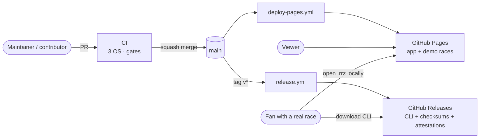

# 07 — GitHub: repository, CI & delivery

Race Replay is hosted on GitHub, in a **public repository on GitHub Free** (ADR-0010). This document covers:

- how the repository is created, from the template shared with racesim;
- how it is configured, as code;
- how it is built, tested, deployed and released with GitHub Actions;
- how the design stays within GitHub's limits.

`OWNER` stands for the GitHub account that owns the repository. Facts about GitHub were checked in October 2026 and are marked where they may drift.

## 1. GitHub services used

| Need | GitHub service | Notes |
|---|---|---|
| Source, docs, decisions | Repository (`main`) | Trunk-based, squash merges, rulesets (§5) |
| Build conventions | Template repository `OWNER/dotnet-lab-template` | Shared with racesim (§2) |
| CI | Actions: `ci.yml` | Linux, Windows and macOS; coverage, docs and publish gates (§6.2) |
| Public site | Pages, deployed by Actions: `deploy-pages.yml` | App plus synthetic demo races (§6.3, §8) |
| CLI downloads | Releases: `release.yml` | Self-contained binaries, checksums, attestations, immutable releases (§9) |
| Hosted mode (opt-in) | Orphan `data` branch plus `build-bundles.yml` | Off in the main repository (ADR-0007, ADR-0008) |
| Security | CodeQL default setup, secret scanning with push protection, Dependabot, private vulnerability reporting, Actions policy | §7 |
| Planning and support | Issues (forms), milestones, labels, Projects (optional), Discussions | §11 |
| Development environment | Codespaces via `.devcontainer/` | §12 |



## 2. Shared template

Race Replay and racesim build the same way. The files that make that true live once, in `OWNER/dotnet-lab-template` (racesim ADR-0009, Part 1).

- **Creating the repository.** Race Replay is created from the template (§3).
- **If Race Replay reaches M0 first,** it creates the template from the files in this document, following the steps in racesim's `docs/design/06-github-and-ci.md` §1.2.
- **Changing shared files.** Changes go to the template first, then are copied into each repository by an ordinary pull request.

### 2.1 What comes from the template

`global.json`, `Directory.Build.props`, `Directory.Packages.props` (test packages), `tests/Directory.Build.props`, `.editorconfig`, `.gitattributes`, `.gitignore`, `dotnet-tools.json`, `scripts/check-coverage.cs`, `scripts/check-docs.cs`, `scripts/setup-github.sh` (labels and milestones), `.github/workflows/ci.yml`, `.github/dependabot.yml`, the pull request template, issue forms, `LICENSE`, `DATA-LICENSE.md`, `NOTICE.md`, and the ADR index and template.

### 2.2 Differences resolved in favour of the template

These were the follow-ups racesim ADR-0009 listed for Race Replay.

| Item | Earlier Race Replay draft | Now |
|---|---|---|
| Action majors | `checkout@v5`, `setup-dotnet@v5`, `upload-artifact@v4`, `configure-pages@v5`, `upload-pages-artifact@v4`, `deploy-pages@v4` | `checkout@v7`, `setup-dotnet@v6`, `upload-artifact@v7`, `configure-pages@v6`, `upload-pages-artifact@v5`, `deploy-pages@v5`. Race Replay also uses `download-artifact@v8`, `cache@v5` and `attest@v4`. All are **pinned to full commit SHAs** in the committed files (§7.2). |
| File-based scripts | No AOT property | Every script starts with `#:property PublishAot=false`. Without it, the first run tries to restore the Native AOT compiler package. |
| `tests/Directory.Build.props` | Condition named `RaceReplay.TestKit` | Any project ending in `.TestKit` stays a library ([06 §2.2](06-testing-strategy.md#22-shared-test-project-settings)) |
| Tool manifest | `.config/dotnet-tools.json` | `dotnet-tools.json` at the root, where `dotnet new tool-manifest` puts it on SDK 10 |
| Dependabot | `microsoft` group first; no ignore rules | Template version: `testing` group first, including `Microsoft.Testing.*`; runtime majors ignored while on .NET 10 LTS. Race Replay adds a `dotnet-sdk` entry (§7.4). |
| Docs gate | Planned (RR-090) | `scripts/check-docs.cs` runs in CI. RR-090 shrinks to Mermaid parsing and snippet compilation. |
| CLI exit codes | 0–4 | Shared convention: 0 success, 1 error, 2 usage, 3 data, 4 validation, **130 cancelled** ([04 §6](04-data-pipeline-and-bundle-format.md#6-cli)) |

### 2.3 Proposed additions to the template

Race Replay needs these. Under the template's rule they go to the template first, so racesim benefits too:

- a `dotnet-sdk` Dependabot entry, so `global.json` follows .NET 10 patch releases (§7.4);
- SHA-pinned actions and the Actions policy settings (§7);
- `.github/rulesets/*.json`, and the settings half of `setup-github.sh` (§5);
- `.devcontainer/devcontainer.json` (§12);
- `SECURITY.md`, `CONTRIBUTING.md` and `.github/release.yml` (§11);
- **Brotli decoding for Blazor on GitHub Pages** ([05 §12](05-web-client.md#12-github-pages-specifics)). racesim's explorer also deploys Blazor to Pages, and its current workflow deletes the `.br` files that make this possible.

## 3. Creating the repository

```bash
gh repo create race-replay --public --clone --template OWNER/dotnet-lab-template \
  --description "Replay historical races: animated track map, scrubbing and a live gap chart (.NET 10, Blazor WebAssembly)"
cd race-replay
./scripts/setup-github.sh          # settings, rulesets, labels, milestones (§5)
```

The project-specific commands that follow, creating the solution, projects and references, are in [08 §2](08-implementation-plan.md#2-bootstrap-from-the-shared-template-m0).

## 4. Repository layout

```text
race-replay/
├─ .devcontainer/
│  └─ devcontainer.json            # Codespaces: .NET 10 SDK, C# Dev Kit (§12)
├─ .github/
│  ├─ workflows/
│  │  ├─ ci.yml                    # PRs and main: 3-OS build-test, gates, site publish check
│  │  ├─ deploy-pages.yml          # main: app + demo races → Pages
│  │  ├─ release.yml               # tags v*: CLI binaries → immutable release
│  │  └─ build-bundles.yml         # hosted mode only
│  ├─ rulesets/
│  │  ├─ main.json                 # branch ruleset (§5.2)
│  │  └─ release-tags.json         # tag ruleset for v*
│  ├─ ISSUE_TEMPLATE/
│  │  ├─ bug.yml
│  │  ├─ data-issue.yml
│  │  ├─ feature.yml
│  │  └─ config.yml                # blank issues off; links to Discussions
│  ├─ dependabot.yml
│  ├─ pull_request_template.md
│  └─ release.yml                  # release-note categories by label
├─ config/
│  ├─ demo-races.json              # seeds and titles of the synthetic demo races
│  ├─ track-orientation.json       # optional display rotation per circuit_key
│  └─ circuits.json                # official lap lengths by OpenF1 circuit_short_name, for validation and scripts
├─ docs/                           # this document set + ADRs + spikes/
│  └─ schema/                      # generated JSON Schemas (golden-tested; published with the site)
├─ scripts/
│  ├─ assemble-site.sh             # shared by ci.yml and deploy-pages.yml (§6.3)
│  ├─ check-coverage.cs            # template; file-based app
│  ├─ check-docs.cs                # template; file-based app
│  └─ setup-github.sh              # repository settings as code (§5)
├─ src/ …                          # see 02 §4.1
├─ tests/ …
│  └─ Directory.Build.props        # template (06 §2.2)
├─ .editorconfig  .gitattributes  .gitignore
├─ Directory.Build.props  Directory.Packages.props  global.json  dotnet-tools.json
├─ RaceReplay.slnx
├─ LICENSE  DATA-LICENSE.md  NOTICE.md
├─ CONTRIBUTING.md  SECURITY.md  CODE_OF_CONDUCT.md
└─ README.md
```

### 4.1 Root configuration

The root files come from the template. Race Replay only sets its identity and adds its own packages.

`global.json` (template):

```json
{
  "sdk": { "version": "10.0.100", "rollForward": "latestFeature" },
  "test": { "runner": "Microsoft.Testing.Platform" }
}
```

- `rollForward: latestFeature` accepts any newer .NET 10 SDK. Dependabot's `dotnet-sdk` updates keep the floor on the latest patch (§7.4), so `setup-dotnet` installs a patched SDK in CI.
- The `test.runner` entry puts `dotnet test` into Microsoft Testing Platform mode, which xUnit v3 4.x needs on the .NET 10 SDK (ADR-0006).

`Directory.Build.props` (template; `RepositoryUrl` and `Product` per repository):

```xml
<Project>
  <PropertyGroup>
    <TargetFramework>net10.0</TargetFramework>
    <Nullable>enable</Nullable>
    <ImplicitUsings>enable</ImplicitUsings>
    <TreatWarningsAsErrors>true</TreatWarningsAsErrors>
    <AnalysisLevel>latest-recommended</AnalysisLevel>
    <EnforceCodeStyleInBuild>true</EnforceCodeStyleInBuild>
    <GenerateDocumentationFile>true</GenerateDocumentationFile>
    <NoWarn>$(NoWarn);CS1591</NoWarn>
    <Deterministic>true</Deterministic>
    <ContinuousIntegrationBuild Condition="'$(GITHUB_ACTIONS)' == 'true'">true</ContinuousIntegrationBuild>
    <RestorePackagesWithLockFile>true</RestorePackagesWithLockFile>
    <RepositoryUrl>https://github.com/OWNER/race-replay</RepositoryUrl>
    <Product>Race Replay</Product>
  </PropertyGroup>
</Project>
```

- `ContinuousIntegrationBuild` on GitHub Actions normalises source paths in PDBs, so builds from different runners are comparable.
- `RepositoryUrl` feeds SourceLink and the package metadata of `OpenF1.Client` (§9.3).
- **Lock files and SDK patches.** Trimmable libraries (Domain, Bundle, Playback) and the WebAssembly app get implicit package references whose versions follow the installed SDK's runtime patch, such as `Microsoft.NET.ILLink.Tasks`. `setup-dotnet` installs the newest .NET 10 SDK, so lock files for those projects would break the locked restore on every .NET patch release. `Directory.Build.targets` turns lock files off for them; every other project keeps its lock file.

`Directory.Packages.props` holds the template's test packages plus Race Replay's runtime packages:

```xml
<ItemGroup Label="Race Replay">
  <PackageVersion Include="System.CommandLine" Version="2.0.0" />
  <PackageVersion Include="Microsoft.Extensions.Hosting" Version="10.0.0" />
  <PackageVersion Include="Microsoft.Extensions.Http.Resilience" Version="10.0.0" />
  <PackageVersion Include="System.Numerics.Tensors" Version="10.0.0" />
  <PackageVersion Include="Microsoft.AspNetCore.Components.WebAssembly" Version="10.0.0" />
  <PackageVersion Include="Microsoft.AspNetCore.Components.WebAssembly.DevServer" Version="10.0.0" />
</ItemGroup>
```

Pin `Microsoft.*` and `System.*` packages to the latest 10.0.x patch at bootstrap. Dependabot raises them after that.

| Other file | Race Replay content |
|---|---|
| `.gitattributes` | Template, plus `*.rrb binary`, `*.rrz binary` |
| `.gitignore` | Template, plus `.cache/`, `publish/`, `replays/`, `*.rrz` (re-included for `tests/**/Golden/`), `reports/`, `src/RaceReplay.Web/wwwroot/bundles/`. This keeps real data out of commits (ADR-0008). |
| `README.md` | What it is, screenshot, **live demo** link, **"Watch a real race in one command"** (download the CLI from Releases, `race-replay build --session <key>`, open the `.rrz`), how to verify a download (§9.2), data policy and attribution, hosted-mode warning, links into `docs/` |

## 5. Repository settings as code

GitHub settings can't be copied by a template, and settings changed by clicking are invisible in review. Race Replay therefore keeps them in the repository.

### 5.1 `scripts/setup-github.sh`

The template supplies the labels and milestones half of this script. Race Replay adds the settings half, which is proposed back to the template (§2.3). Run it once after creating the repository, and again after editing it. It is safe to re-run.

```bash
#!/usr/bin/env bash
# Applies race-replay's GitHub settings. Safe to re-run.
# Requires: gh (authenticated as a repository admin), jq. Usage: scripts/setup-github.sh [OWNER/REPO]
set -euo pipefail
repo="${1:-$(gh repo view --json nameWithOwner -q .nameWithOwner)}"

# Merging: squash only, tidy branches, Discussions on, wiki off (docs live in docs/)
gh repo edit "$repo" --enable-squash-merge --enable-merge-commit=false --enable-rebase-merge=false \
  --delete-branch-on-merge --enable-discussions --enable-wiki=false

# Actions: read-only GITHUB_TOKEN by default; workflows can't approve PRs; GitHub-owned actions only,
# pinned to full commit SHAs
gh api -X PUT "repos/$repo/actions/permissions/workflow" \
  -f default_workflow_permissions=read -F can_approve_pull_request_reviews=false
gh api -X PUT "repos/$repo/actions/permissions" -F enabled=true -f allowed_actions=selected \
  -F sha_pinning_required=true
gh api -X PUT "repos/$repo/actions/permissions/selected-actions" \
  -F github_owned_allowed=true -F verified_allowed=false

# Pages: deploy from GitHub Actions (create, or update if it already exists)
gh api -X POST "repos/$repo/pages" -f build_type=workflow >/dev/null 2>&1 \
  || gh api -X PUT "repos/$repo/pages" -f build_type=workflow

# Security features
gh api -X PUT "repos/$repo/vulnerability-alerts"
gh api -X PUT "repos/$repo/automated-security-fixes"
gh api -X PUT "repos/$repo/private-vulnerability-reporting"
gh api -X PATCH "repos/$repo/code-scanning/default-setup" -f state=configured >/dev/null
gh api -X PATCH "repos/$repo" --input - >/dev/null <<'JSON'
{ "security_and_analysis": {
    "secret_scanning": { "status": "enabled" },
    "secret_scanning_push_protection": { "status": "enabled" } } }
JSON

# Rulesets: create or replace from the committed JSON (§5.2)
for file in .github/rulesets/*.json; do
  name=$(jq -r .name "$file")
  id=$(gh api "repos/$repo/rulesets" -q ".[] | select(.name==\"$name\") | .id")
  if [[ -n "$id" ]]; then gh api -X PUT "repos/$repo/rulesets/$id" --input "$file" >/dev/null
  else gh api -X POST "repos/$repo/rulesets" --input "$file" >/dev/null; fi
done

# Labels: shared scheme with racesim (type:, area:), plus Race Replay's own
for t in feature bug spike docs chore; do gh label create "type:$t" -R "$repo" --color 1D76DB --force; done
for a in domain analysis application bundle ingest synthetic playback cli web ci docs; do
  gh label create "area:$a" -R "$repo" --color 0E8A16 --force
done
gh label create data-policy -R "$repo" --color B60205 --force \
  --description "Changes what data is built, packaged or published (ADR-0008)"
gh label create "good first issue" -R "$repo" --color 7057FF --force

# Milestones from the implementation plan (08); created only if missing
existing=$(gh api "repos/$repo/milestones?state=all&per_page=100" -q '.[].title')
for m in "M0 Bootstrap" "M1 Walking skeleton" "S1+S2 Spikes" "M2 Analysis core" \
         "M3 OpenF1, Application, CLI" "M4 Bundle format and packages" \
         "M5 Charts and context" "M6 Delivery" "M7 Hardening and v1.0"; do
  grep -Fxq "$m" <<<"$existing" || gh api "repos/$repo/milestones" -f title="$m" >/dev/null
done

echo "Done. Now complete the manual checklist in docs/07-repository-ci-and-delivery.md §5.3."
```

### 5.2 Rulesets

Rulesets are committed as JSON. The easiest way to get the exact schema is to create the ruleset once in the UI, export it, and commit the export. The script then re-applies it.

`.github/rulesets/main.json`:

```json
{
  "name": "main",
  "target": "branch",
  "enforcement": "active",
  "conditions": { "ref_name": { "include": ["~DEFAULT_BRANCH"], "exclude": [] } },
  "bypass_actors": [],
  "rules": [
    { "type": "deletion" },
    { "type": "non_fast_forward" },
    { "type": "required_linear_history" },
    { "type": "pull_request", "parameters": {
        "required_approving_review_count": 0,
        "dismiss_stale_reviews_on_push": false,
        "require_code_owner_review": false,
        "require_last_push_approval": false,
        "required_review_thread_resolution": true,
        "allowed_merge_methods": ["squash"] } },
    { "type": "required_status_checks", "parameters": {
        "strict_required_status_checks_policy": false,
        "required_status_checks": [
          { "context": "build-test (ubuntu-latest)" },
          { "context": "build-test (windows-latest)" },
          { "context": "build-test (macos-latest)" },
          { "context": "publish-site" } ] } }
  ]
}
```

- **Approvals.** No approving review is required, so a solo maintainer can merge their own pull request, but only when every check is green. Raise the count when a second maintainer joins.
- **`release-tags.json`** targets tags matching `refs/tags/v*` with `deletion` and `non_fast_forward`. Release tags can't be moved or deleted, even before immutable releases lock them.
- **Hosted mode** adds a `data.json` ruleset for the `data` branch, with `deletion` and `non_fast_forward` only. The bundle workflow pushes to it directly.

### 5.3 Manual checklist

These settings are set in the UI, either because the API fields weren't confirmed when this was written or because they are one-off.

| Setting | Where | Value |
|---|---|---|
| Release immutability | Settings → General → Releases | On (§9.1) |
| `github-pages` environment | Settings → Environments | Deployment branches: `main` only |
| Fork pull request workflows | Settings → Actions → General | Require approval for first-time contributors (default) |
| Social preview image, topics | Settings → General / repository home | Screenshot of a demo race; topics `dotnet`, `blazor`, `webassembly`, `formula-1`, `data-visualisation` |
| Custom domain (optional) | Settings → Pages | If used: set `SITE_BASE_PATH=/` (§8), enforce HTTPS |

## 6. GitHub Actions workflows

### 6.1 Overview

| Workflow | Trigger | Jobs and token permissions | Required check |
|---|---|---|---|
| `ci.yml` | PR, push to `main`, manual | `build-test` × 3 OS, `publish-site`: `contents: read` | Yes, all four |
| `deploy-pages.yml` | Push to `main` (code and site inputs), manual, after `Build bundles` (hosted mode) | `build`: `contents: read`; `deploy`: `pages: write`, `id-token: write` | — |
| `release.yml` | Tag `v*` | `test`, `build` × 3 platforms: `contents: read`; `publish`: `contents: write`, `id-token: write`, `attestations: write` | — |
| `build-bundles.yml` | Manual, hosted mode only | `build`: `contents: read`; `commit`: `contents: write` | — |

**Conventions**

- Top-level `permissions: contents: read`. A job elevates only what it needs.
- Inputs reach scripts through `env:`, never by `${{ }}` interpolation into `run:`.
- `pull_request_target` is never used.

The snippets below show action **tags** for readability. The committed files pin each action to its full commit SHA with the tag as a comment (§7.2).

### 6.2 `ci.yml`

This is the template's workflow plus Race Replay's additions:

- **macOS joins the matrix.** Users run the CLI on all three platforms (ADR-0008).
- **A `publish-site` job** publishes the WebAssembly app. Trimming warnings only appear at publish time, and warnings are errors.
- **A site preview** of each pull request is uploaded as an artifact, because Pages has no pull-request previews.

```yaml
name: CI

on:
  push:
    branches: [main]
  pull_request:
  workflow_dispatch:

permissions:
  contents: read

concurrency:
  group: ci-${{ github.ref }}
  cancel-in-progress: true

env:
  DOTNET_NOLOGO: true
  DOTNET_CLI_TELEMETRY_OPTOUT: true

jobs:
  build-test:
    name: build-test (${{ matrix.os }})
    runs-on: ${{ matrix.os }}
    strategy:
      fail-fast: false
      matrix:
        os: [ubuntu-latest, windows-latest, macos-latest]
    defaults:
      run:
        shell: bash
    steps:
      - uses: actions/checkout@v7

      - uses: actions/setup-dotnet@v6
        with:
          global-json-file: global.json
          cache: true
          cache-dependency-path: '**/packages.lock.json'

      - name: Restore (locked)
        run: |
          dotnet restore --locked-mode
          dotnet tool restore

      - name: Check formatting
        if: matrix.os == 'ubuntu-latest'
        run: dotnet format --verify-no-changes --no-restore

      - name: Build
        run: dotnet build --no-restore -c Release

      - name: Test
        run: >
          dotnet test --no-build -c Release
          --coverage --coverage-output-format cobertura
          --report-xunit-trx
          --results-directory TestResults

      - name: Coverage report and gate
        if: matrix.os == 'ubuntu-latest'
        run: |
          dotnet reportgenerator -reports:"TestResults/**/*.cobertura.xml" \
            -targetdir:coverage -reporttypes:"Cobertura;MarkdownSummaryGithub"
          cat coverage/SummaryGithub.md >> "$GITHUB_STEP_SUMMARY"
          dotnet run scripts/check-coverage.cs -- coverage/Cobertura.xml

      - name: Docs gate
        if: matrix.os == 'ubuntu-latest'
        run: dotnet run scripts/check-docs.cs -- .

      - name: Upload test results
        if: always()
        uses: actions/upload-artifact@v7
        with:
          name: test-results-${{ matrix.os }}
          path: |
            TestResults/
            coverage/
          retention-days: 14

  publish-site:
    runs-on: ubuntu-latest
    steps:
      - uses: actions/checkout@v7

      - uses: actions/setup-dotnet@v6
        with:
          global-json-file: global.json
          cache: true
          cache-dependency-path: '**/packages.lock.json'

      - name: Publish web app (trim analysis; warnings are errors)
        run: dotnet publish src/RaceReplay.Web -c Release -o publish

      - name: Assemble site (demo races, catalogue, data-policy check)
        run: scripts/assemble-site.sh publish/wwwroot --base-path /

      - name: Upload site preview
        if: github.event_name == 'pull_request'
        uses: actions/upload-artifact@v7
        with:
          name: site-preview
          path: publish/wwwroot
          retention-days: 7
```

**Notes**

- **Required checks.** The four check names are what the `main` ruleset requires (§5.2).
- **Gates run once, on Linux.** Coverage, docs links and formatting don't depend on the OS.
- **Reference platform.** Golden-byte tests assert exact bytes only on `ubuntu-latest` x64. Elsewhere they check round-trips within tolerance ([06 §7](06-testing-strategy.md#7-golden-file-and-determinism-tests)).
- **Previewing a pull request.** Download the `site-preview` artifact, unzip it, and serve it locally with any static server, for example `dnx dotnet-serve -d site-preview`, using .NET 10's one-shot tool runner. Then open a demo race.
- **Cost.** macOS and Windows runners are free for public repositories. `cancel-in-progress` stops superseded runs.

### 6.3 `deploy-pages.yml` and `scripts/assemble-site.sh`

Site assembly lives in one script, which both CI and deployment run. A pull request therefore exercises exactly the steps that deployment will.

```bash
#!/usr/bin/env bash
# Assembles the static site around a published RaceReplay.Web. Runs on Linux (CI, Codespaces).
# Usage: scripts/assemble-site.sh <site-dir> [--base-path /race-replay/] [--hosted <bundles-dir>]
set -euo pipefail
site="$1"; shift
base="/"; hosted=""
while (($#)); do
  case "$1" in
    --base-path) base="$2"; shift 2 ;;
    --hosted)    hosted="$2"; shift 2 ;;
    *) echo "unknown option: $1" >&2; exit 2 ;;
  esac
done
cli=(dotnet run --project src/RaceReplay.Cli -c Release --)

# 1. Synthetic demo races: deterministic, no network
for seed in $(jq -r '.races[].seed' config/demo-races.json); do
  "${cli[@]}" build --source synthetic --seed "$seed" --layout directory --out "$site/bundles/demo"
done

# 2. Hosted bundles: opt-in only (ADR-0008)
if [[ -n "$hosted" ]]; then cp -r "$hosted/." "$site/bundles/"; fi

# 3. Data-policy check: nothing but synthetic data unless hosted mode is on
if [[ -z "$hosted" ]]; then
  while IFS= read -r -d '' manifest; do
    origin=$(jq -r '.provenance.source' "$manifest")
    if [[ "$origin" != "synthetic" ]]; then
      echo "::error file=$manifest::'$origin' bundle found but hosted mode is off (ADR-0008)"; exit 1
    fi
  done < <(find "$site/bundles" -name manifest.json -print0)
fi

# 4. Catalogue (carries the site mode, so published app files are never edited) and schemas
"${cli[@]}" catalog --bundles "$site/bundles" --mode "$([[ -n "$hosted" ]] && echo hosted || echo demo)"
cp -r docs/schema "$site/schema"

# 5. Compression: Pages can't negotiate pre-compressed files. Keep the Brotli copies for the
#    in-browser decoder (05 §12); drop the unused gzip copies of framework files.
find "$site/_framework" -name '*.gz' -delete

# 6. Base path and SPA deep-link fallback
sed -i "s|<base href=\"/\" />|<base href=\"${base}\" />|" "$site/index.html"
cp "$site/index.html" "$site/404.html"

# 7. Size budget: a published Pages site may be at most 1 GB
size_mb=$(du -sm "$site" | cut -f1)
echo "Site size: ${size_mb} MB" >> "${GITHUB_STEP_SUMMARY:-/dev/null}"
if (( size_mb >= 900 )); then echo "::error::Site is ${size_mb} MB (Pages limit 1 GB)"; exit 1; fi
if (( size_mb >= 500 )); then echo "::warning::Site is ${size_mb} MB (budget warning at 500 MB)"; fi
```

```yaml
name: Deploy site

on:
  push:
    branches: [main]
    paths-ignore:
      - 'docs/*.md'
      - 'docs/adr/**'
      - 'docs/spikes/**'
      - '*.md'
  workflow_run:
    workflows: ["Build bundles"]          # hosted mode only
    types: [completed]
  workflow_dispatch:

permissions:
  contents: read

concurrency:
  group: pages
  cancel-in-progress: false

jobs:
  build:
    if: github.event_name != 'workflow_run' || github.event.workflow_run.conclusion == 'success'
    runs-on: ubuntu-latest
    env:
      HOSTED: ${{ vars.HOSTED_BUNDLES == 'true' }}
      BASE_PATH: ${{ vars.SITE_BASE_PATH || format('/{0}/', github.event.repository.name) }}
    steps:
      - uses: actions/checkout@v7

      - uses: actions/setup-dotnet@v6
        with:
          global-json-file: global.json

      - name: Publish web app
        run: dotnet publish src/RaceReplay.Web -c Release -o publish

      - name: Check out hosted bundles (opt-in)
        if: env.HOSTED == 'true'
        uses: actions/checkout@v7
        with:
          ref: data
          path: data

      - name: Assemble site
        run: |
          args=(--base-path "$BASE_PATH")
          if [[ "$HOSTED" == "true" ]]; then args+=(--hosted data/bundles); fi
          scripts/assemble-site.sh publish/wwwroot "${args[@]}"

      - uses: actions/configure-pages@v6

      - uses: actions/upload-pages-artifact@v5
        with:
          path: publish/wwwroot

  deploy:
    needs: build
    runs-on: ubuntu-latest
    permissions:
      pages: write
      id-token: write
    environment:
      name: github-pages
      url: ${{ steps.deployment.outputs.page_url }}
    steps:
      - id: deployment
        uses: actions/deploy-pages@v5
```

**Notes**

- **No separate test step.** The ruleset only lets green commits reach `main`, and `publish-site` has already run the same assembly on the pull request.
- **Executable scripts.** `scripts/*.sh` are committed with the executable bit (`git update-index --chmod=+x`), which matters because Windows checkouts can't set it.
- **`paths-ignore`.** Documentation-only changes don't redeploy. `docs/schema/` is not ignored, because the schemas are published with the site.
- **No Jekyll.** Deploying through Actions skips Jekyll, so `_framework` is served as-is and no `.nojekyll` file is needed.
- **Base path.** A project site lives under `/<repository>/`. `SITE_BASE_PATH` overrides it, for example `/` for a custom domain.
- **Line endings.** The built artifact is uploaded directly. No `gh-pages` branch is committed, so Git line-ending conversion can't break Blazor's integrity hashes.

### 6.4 `release.yml`

Each platform is built on a **native runner**. That avoids cross-OS publishing caveats such as macOS code signing, and lets the release switch to Native AOT later without restructuring. The job holding `contents: write` only packages, attests and publishes.

```yaml
name: Release

on:
  push:
    tags: ['v*']

permissions:
  contents: read

jobs:
  test:
    runs-on: ubuntu-latest
    steps:
      - uses: actions/checkout@v7
      - uses: actions/setup-dotnet@v6
        with:
          global-json-file: global.json
      - run: dotnet test -c Release

  build:
    needs: test
    strategy:
      matrix:
        include:
          - { rid: linux-x64, os: ubuntu-latest }
          - { rid: win-x64,   os: windows-latest }
          - { rid: osx-arm64, os: macos-latest }
    runs-on: ${{ matrix.os }}
    defaults:
      run:
        shell: bash
    steps:
      - uses: actions/checkout@v7
      - uses: actions/setup-dotnet@v6
        with:
          global-json-file: global.json

      - name: Publish self-contained CLI
        env:
          RID: ${{ matrix.rid }}
        run: |
          version="${GITHUB_REF_NAME#v}"
          dotnet publish src/RaceReplay.Cli -c Release -r "$RID" --self-contained \
            -p:PublishSingleFile=true -p:Version="$version" -o "out/$RID"

      - uses: actions/upload-artifact@v7
        with:
          name: cli-${{ matrix.rid }}
          path: out/${{ matrix.rid }}
          retention-days: 1

  publish:
    needs: build
    runs-on: ubuntu-latest
    permissions:
      contents: write        # create the release
      id-token: write        # sign attestations (Sigstore, via OIDC)
      attestations: write    # store attestations
    steps:
      - uses: actions/download-artifact@v8
        with:
          pattern: cli-*
          path: out

      - name: Package and checksum
        run: |
          version="${GITHUB_REF_NAME#v}"
          cd out
          for dir in cli-*; do
            rid="${dir#cli-}"
            # Artifacts don't preserve file modes; restore the executable bit before zipping.
            [[ "$rid" == win-* ]] || chmod +x "$dir/race-replay"
            (cd "$dir" && zip -qr "../race-replay-$version-$rid.zip" .)
          done
          sha256sum race-replay-*.zip > SHA256SUMS.txt

      - name: Attest build provenance
        uses: actions/attest@v4
        with:
          subject-path: 'out/race-replay-*.zip'

      - name: Create immutable release (draft, upload, publish)
        env:
          GH_TOKEN: ${{ github.token }}
        run: |
          gh release create "$GITHUB_REF_NAME" -R "$GITHUB_REPOSITORY" --draft --verify-tag --generate-notes
          gh release upload "$GITHUB_REF_NAME" -R "$GITHUB_REPOSITORY" out/race-replay-*.zip out/SHA256SUMS.txt
          gh release edit "$GITHUB_REF_NAME" -R "$GITHUB_REPOSITORY" --draft=false
```

**Notes**

- **Versioning.** The version comes from the tag, so nothing is bumped in files. `--verify-tag` refuses a tag that isn't on the remote.
- **Draft, upload, publish.** This is GitHub's recommended flow for immutable releases. Assets are locked once the release is published.
- **Executable bits.** Workflow artifacts don't preserve file permissions, so the publish job restores the executable bit before zipping. The CLI project sets `<AssemblyName>race-replay</AssemblyName>`, so the binary is called `race-replay`.
- **Signing.** The macOS build runs on a macOS runner, where the SDK ad-hoc signs the binary, which Apple Silicon requires.
- **Release notes** are generated and grouped by `type:` labels via `.github/release.yml` (§11).

### 6.5 `build-bundles.yml` (hosted mode only)

> The main repository leaves `HOSTED_BUNDLES` unset and doesn't use this workflow. It is documented for personal or private deployments that choose to host real bundles (ADR-0008).

The workflow is split so that the job that talks to OpenF1 can't write to the repository.

```yaml
name: Build bundles

on:
  workflow_dispatch:
    inputs:
      sessions:
        description: "OpenF1 session keys, space-separated (e.g. 9839 9850)"
        required: true
      refresh:
        description: "Bypass the OpenF1 response cache"
        type: boolean
        default: false

permissions:
  contents: read

concurrency:
  group: bundles
  cancel-in-progress: false

jobs:
  build:
    runs-on: ubuntu-latest
    env:
      SESSIONS: ${{ inputs.sessions }}     # via env, never interpolated into scripts
      REFRESH: ${{ inputs.refresh }}
    steps:
      - name: Validate input
        run: '[[ "$SESSIONS" =~ ^[0-9]+( [0-9]+)*$ ]] || { echo "::error::Invalid session keys"; exit 1; }'

      - uses: actions/checkout@v7
      - uses: actions/setup-dotnet@v6
        with:
          global-json-file: global.json

      - uses: actions/cache@v5
        with:
          path: .cache/openf1
          key: openf1-${{ github.run_id }}
          restore-keys: openf1-

      - name: Build bundles
        run: |
          flag=""; if [[ "$REFRESH" == "true" ]]; then flag="--refresh"; fi
          for s in $SESSIONS; do
            dotnet run --project src/RaceReplay.Cli -c Release -- build --session "$s" \
              --layout directory --out out/bundles --cache .cache/openf1 $flag --report "out/reports/$s.md"
            cat "out/reports/$s.md" >> "$GITHUB_STEP_SUMMARY"
          done

      - uses: actions/upload-artifact@v7
        with:
          name: bundles
          path: out/
          retention-days: 7

  commit:
    needs: build
    runs-on: ubuntu-latest
    permissions:
      contents: write
    env:
      SESSIONS: ${{ inputs.sessions }}
    steps:
      - uses: actions/checkout@v7
        with:
          ref: data

      - uses: actions/download-artifact@v8
        with:
          name: bundles
          path: incoming

      - name: Commit to data branch
        run: |
          cp -r incoming/bundles/. bundles/
          git config user.name "github-actions[bot]"
          git config user.email "41898282+github-actions[bot]@users.noreply.github.com"
          git add bundles
          git diff --cached --quiet || git commit -m "data: bundles for ${SESSIONS}"
          git push
```

**Notes**

- **The CI cache is opportunistic.** Entries unused for 7 days are evicted, and race weekends are often further apart. A cold cache only costs a rate-limited refetch, about a minute per race (§10).
- **Redeploying.** Pushes made with `GITHUB_TOKEN` don't trigger `push` workflows. That is why `deploy-pages.yml` listens for `workflow_run`.
- **The catalogue** is regenerated at deploy time by `assemble-site.sh`, so this workflow only adds bundle directories.

## 7. Supply chain and security

### 7.1 Baseline

| Control | How |
|---|---|
| Least-privilege tokens | Repository default `GITHUB_TOKEN` is read-only (§5.1). Workflows declare `contents: read` at the top and elevate per job (§6.1). |
| Trusted actions only | Actions policy allows GitHub-owned actions only (`actions/*`, `github/*`). Every workflow here uses nothing else. |
| Immutable action references | Every `uses:` is pinned to a full commit SHA. `setup-github.sh` turns on the repository policy that requires this (§5.1). |
| No untrusted code with secrets | No `pull_request_target`, and no secrets at all. Fork PRs need approval for first-time contributors. |
| Code scanning | CodeQL default setup: C#, JavaScript (the JS shims), and GitHub Actions workflows, which CodeQL has built-in queries for |
| Secrets | Secret scanning with push protection. The project needs no secrets, so any finding is a mistake. |
| Dependencies | Dependabot alerts and security updates; weekly version updates (§7.4); lock files with `--locked-mode` restore |
| Vulnerability reports | Private vulnerability reporting, described in `SECURITY.md` |
| Release integrity | Build-provenance attestations, `SHA256SUMS.txt`, immutable releases, protected `v*` tags (§5.2, §9) |

### 7.2 Pinning actions

Committed workflows look like this:

```yaml
- uses: actions/checkout@<full 40-character commit SHA>   # v7.0.1
```

- **Producing the pins.** Look up each tag's commit, for example `gh api repos/actions/checkout/git/ref/tags/v7.0.1 -q .object.sha`. For annotated tags, follow the tag object to its commit.
- **Keeping them current.** Dependabot understands SHA pins with version comments and updates both.
- **Readability.** Documents show tags, and the comment keeps the version readable in the committed file.

### 7.3 Community health files

| File | Content |
|---|---|
| `SECURITY.md` | How to report a vulnerability privately (GitHub's "Report a vulnerability" button), supported versions (latest release), and what is in scope: the CLI, the web app, package parsing |
| `CONTRIBUTING.md` | Setup (Codespaces or local), the PR checklist, Conventional Commit titles, the data policy (no real data in commits), how to add a synthetic seed or an event extractor |
| `CODE_OF_CONDUCT.md` | Contributor Covenant, via GitHub's template |

### 7.4 `.github/dependabot.yml`

```yaml
version: 2
updates:
  - package-ecosystem: nuget
    directory: /
    schedule:
      interval: weekly
    groups:
      testing:
        patterns: ["xunit*", "Microsoft.Testing.*", "CsCheck", "bunit"]
      microsoft:
        patterns: ["Microsoft.*", "System.*"]
    ignore:
      # Stay on .NET 10 LTS until ADR-0001 is revisited.
      - dependency-name: "Microsoft.AspNetCore.*"
        update-types: ["version-update:semver-major"]
      - dependency-name: "Microsoft.Extensions.*"
        update-types: ["version-update:semver-major"]
      - dependency-name: "System.Numerics.Tensors"
        update-types: ["version-update:semver-major"]
    open-pull-requests-limit: 5

  - package-ecosystem: dotnet-sdk          # keeps global.json on the latest .NET 10 patch
    directory: /
    schedule:
      interval: weekly
    ignore:
      - dependency-name: "*"
        update-types: ["version-update:semver-major"]

  - package-ecosystem: github-actions
    directory: /
    schedule:
      interval: weekly
    groups:
      actions:
        patterns: ["*"]
```

- **Group order matters.** A package joins the first group it matches, so `testing` comes first, as in the template.
- **The `dotnet-sdk` ecosystem** updates `global.json`. Without it, `setup-dotnet` would keep installing the original `10.0.100` floor in CI, missing SDK security patches. This entry is proposed to the template (§2.3).
- **`System.Numerics.Tensors`** versions with the runtime, so its major updates are ignored too.

## 8. GitHub Pages: constraints and responses

Pages is a fixed static host. The client is designed around that, and the detail is in [05 §12](05-web-client.md#12-github-pages-specifics).

| Pages behaviour | Consequence | Design response |
|---|---|---|
| No server-side negotiation of pre-compressed files | Blazor's `.br` files would go unused | Keep `.br` files, decode in the browser via `loadBootResource` (Microsoft's documented approach) |
| No custom response headers | No HTTP CSP, no COOP/COEP | CSP via `<meta>` (M7). No WebAssembly threads; the design is single-threaded. |
| Short, fixed cache lifetime (reported `max-age=600`) | Repeat visits revalidate often | Fingerprinted assets plus Blazor's boot-resource cache |
| Project sites live under `/<repo>/` | Absolute URLs break | Base-path rewrite; relative URLs only |
| Unknown paths return `404.html` | Deep links would 404 | `404.html` is a copy of `index.html`, and the client routes |
| 1 GB per site, 100 GB/month soft bandwidth | Hosted mode could grow | Budget check in `assemble-site.sh` (§6.3, §10) |

## 9. Releases and distribution

### 9.1 What a release contains

| Asset | Purpose |
|---|---|
| `race-replay-<version>-linux-x64.zip`, `-win-x64.zip`, `-osx-arm64.zip` | Self-contained, single-file CLI; no .NET SDK needed (assumption A5) |
| `SHA256SUMS.txt` | Quick integrity check |
| Build-provenance attestations (stored by GitHub, not as assets) | Proves each zip was built by this repository's `release.yml` from the tagged commit |
| Release attestation (automatic for immutable releases) | Proves the release's assets and tag haven't changed since publication |

### 9.2 Verifying a download

The README tells users how to check a download before running it:

```bash
gh attestation verify race-replay-1.0.0-linux-x64.zip -R OWNER/race-replay
sha256sum -c SHA256SUMS.txt --ignore-missing
```

On macOS, a downloaded, unsigned binary is quarantined by Gatekeeper. The README documents the one-time `xattr -d com.apple.quarantine` step. Developer ID signing and notarisation need a paid Apple account and are out of scope.

### 9.3 Packages and the shared OpenF1 client

- **GitHub Packages is not used** for anything users or contributors restore. Its NuGet registry needs an access token even for public packages.
- **`OpenF1.Client`.** Race Replay builds the OpenF1 client (DTOs, JSON context, response cache, rate limiter, resilience) as a separate, packable project with no Race Replay dependencies ([02 §4.1](02-architecture.md#41-solution-layout)). How it is shared with racesim is racesim ADR-0009 Part 2, proposed as nuget.org and decided after Race Replay's M3. Publishing would add a `pack` and `nuget push` job triggered by an `openf1-client-v*` tag, using **nuget.org trusted publishing** if available, or else an API-key secret. That would be the project's first secret.
- **Optional, post-MVP: a `dotnet tool` on nuget.org.** People with the .NET SDK could then run `dnx RaceReplay.Cli build --session 9839` without installing anything. Releases remain the primary channel.

## 10. Platform limits and budgets

These figures were checked in October 2026 and drift over time, so re-check GitHub's documentation when planning hosted mode.

| Limit | Value | Race Replay usage | Guard |
|---|---|---|---|
| Pages: published site size | 1 GB | Demo mode: app with Brotli copies, three demo races and schemas, well under 100 MB. Hosted mode adds about 5 MB per race, so roughly 150 races fit. | `assemble-site.sh` warns at 500 MB and fails at 900 MB |
| Pages: bandwidth | 100 GB/month (soft) | A first visit is about 3 MB of app (Brotli) plus about 3 MB of demo race, so roughly 15,000 first visits a month | Boot-resource caching makes repeat visits cheap. Watch traffic in Insights. |
| Pages: deployment timeout | 10 minutes | Under 1 minute | — |
| Pages: builds per hour | 10 (soft) | Doesn't apply to Actions deployments | — |
| Repository size | Recommended under 1 GB; files over 100 MiB are rejected | `main`: a few MB. Hosted-mode `data` branch: 100–150 MB a season. | `.gitignore` keeps packages out; squash `data` when needed (§13) |
| Actions minutes (standard runners) | Free for public repositories | CI on 3 OS per pull request | `cancel-in-progress`; gates run on Linux only |
| Actions cache | 10 GB per repository; evicted after 7 days unused | NuGet caches per OS (hundreds of MB). Hosted mode: OpenF1 raw responses, about 75 MB a race. | Treated as opportunistic; correctness never depends on a hit |
| Artifact retention | Default 90 days, configurable per upload | Test results 14 days, site previews 7, CLI build outputs 1 (release assets persist) | `retention-days` on every upload |
| Job duration (GitHub-hosted) | 6 hours | Rebuilding a hosted season from cold: about 30 minutes | — |
| Release assets | Each under 2 GiB | Roughly 35–70 MB per zip | — |

## 11. Collaboration on GitHub

- **Branches and merging.** Trunk-based development. Short-lived branches (`feat/…`, `fix/…`, `spike/…`, `docs/…`) are squash-merged through pull requests.
- **Conventional Commit PR titles** (`feat(analysis): virtual leader gaps`) become the commit messages.
- **Labels.** `type:` and `area:` labels (shared scheme), plus `data-policy` for anything that changes what is built, packaged or published.
- **Release notes.** `.github/release.yml` groups generated notes by `type:` label:

  ```yaml
  changelog:
    exclude:
      labels: ["type:chore"]
    categories:
      - title: Features
        labels: ["type:feature"]
      - title: Fixes
        labels: ["type:bug"]
      - title: Documentation
        labels: ["type:docs"]
      - title: Other changes
        labels: ["*"]
  ```

- **Issue forms** (template, customised wording):
  - *Bug*: browser, URL with `?t=`, CLI version, steps.
  - *Data issue*: session key, driver, time, what looks wrong, the build report attached; real data is never attached.
  - *Feature*.

  `config.yml` turns off blank issues and links to Discussions.
- **Discussions.**
  - *Q&A*: "How do I build race X?" and CLI troubleshooting.
  - *Show and tell*: screenshots of replays.
  - *Ideas*.

  This keeps the issue tracker for actionable work.
- **Milestones** M0–M7 mirror [08](08-implementation-plan.md). Issue titles carry backlog IDs (`RR-031 …`).
- **Projects.** A GitHub Project board (*Backlog → Ready → In progress → In review → Done*) is optional for a solo maintainer.
- **Pull request template** (template, plus Race Replay's checklist):
  - tests added or updated;
  - docs or ADR updated;
  - no new warnings;
  - screenshots for UI changes;
  - `data-policy` label and reasoning if the change affects what is published;
  - no real-race bundles or packages, and no raw OpenF1 responses beyond trimmed fixtures.

## 12. Codespaces and local development

`.devcontainer/devcontainer.json` gives a ready environment in GitHub Codespaces, or locally in VS Code dev containers:

```json
{
  "name": "race-replay",
  "image": "mcr.microsoft.com/devcontainers/dotnet:10.0",
  "features": {
    "ghcr.io/devcontainers/features/github-cli:1": {}
  },
  "postCreateCommand": "dotnet restore && dotnet tool restore",
  "customizations": {
    "vscode": { "extensions": ["ms-dotnettools.csdevkit"] }
  }
}
```

The image tag is checked at M0. Codespaces forwards the port `dotnet watch` opens, so the app runs in the browser with no local install.

**Everyday commands**

```bash
dotnet build
dotnet test

# A local site with demo races (synthetic, no network; output is git-ignored)
dotnet publish src/RaceReplay.Web -c Release -o publish
scripts/assemble-site.sh publish/wwwroot --base-path /
dnx dotnet-serve -d publish/wwwroot

# Or develop with hot reload (demo bundles generated into wwwroot/bundles)
dotnet run --project src/RaceReplay.Cli -- build --source synthetic --seed 1 --layout directory --out src/RaceReplay.Web/wwwroot/bundles/demo
dotnet run --project src/RaceReplay.Cli -- catalog --bundles src/RaceReplay.Web/wwwroot/bundles --mode demo
dotnet watch --project src/RaceReplay.Web

# A real race as a package; open it in the app with "Open replay…" (git-ignored)
dotnet run --project src/RaceReplay.Cli -- build --session 9839 --out replays
```

Visual Studio 2026, Rider, and VS Code with C# Dev Kit all support `.slnx` and Microsoft Testing Platform.

## 13. The `data` branch (hosted mode only)

In hosted mode, real-race bundles live on an **orphan branch** (ADR-0007). The main repository doesn't create it (ADR-0008).

```bash
git switch --orphan data
mkdir bundles
git show main:DATA-LICENSE.md > DATA-LICENSE.md     # licence travels with the data
git add . && git commit -m "data: initialise bundle store"
git push -u origin data
git switch main
```

Then add the `data.json` ruleset (§5.2) and set the repository variable `HOSTED_BUNDLES=true`.

**Growth.**

- A season is roughly 100–150 MB.
- The site-size guard (§6.3) and the repository-size recommendation (§10) bound it.
- When history grows large, squash the branch. Bundles are derived artifacts, and Pages deploys only the branch tip.

## 14. Licensing files

| File | Content |
|---|---|
| `LICENSE` | MIT, for all source code |
| `DATA-LICENSE.md` | The data policy (ADR-0008). Real-race packages users build, hosted-mode bundles and the trimmed test fixtures are derived from OpenF1 data under **CC BY-NC-SA 4.0**, with the attribution "Data: OpenF1 (openf1.org)". Synthetic demo races contain no third-party data. |
| `NOTICE.md` | Race Replay is an unofficial fan project, not affiliated with the Formula 1 companies. F1 and related marks are trademarks of Formula One Licensing B.V. |

The web app footer carries the unofficial-project notice. `DataNotice` shows "Synthetic demo — fictional data" or the OpenF1 attribution for the open replay (NFR-12). Every real package contains a `DATA-NOTICE.txt`.
