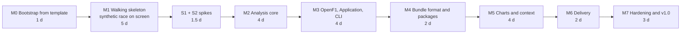

# 08 — Implementation plan

## 1. Approach

- **A product walking skeleton in the first week.** M0 creates the repository from the shared template and applies its GitHub settings as code. It then gets an empty solution building and testing on three operating systems and deploying to Pages. M1 then puts a **synthetic race on screen**: generated, packaged, loaded and animated with clock and scrubber on GitHub Pages. Interop, rendering and UX problems surface before any real-data work, and every later milestone slots in behind a working player.
- **Core proven before real data.** The analysis core (M2) is built and proven against synthetic races with known ground truth before OpenF1 arrives (M3). Real-data problems then show up as *data* problems, not *maths* problems.
- **Spikes before commitment.** Spike S0 (interop performance) is measured inside M1. Spikes S1 (real data) and S2 (packaging and hosting) run before the milestones that depend on them.
- **Contingency and a cut line are part of the plan** (§6), not an afterthought.
- Sizes are in **focused days** (A3 in the proposal).



Subtotal 26.5 days, plus 30 % contingency, so **plan for about 35 focused days** (§6).

**Touch points with racesim** (racesim ADR-0009):

- **M0:** the shared template. Whichever project starts first creates it.
- **S1:** OpenF1 findings, such as race-control wording, written once and shared.
- **End of M3:** the decision on publishing `OpenF1.Client`.

## 2. Bootstrap from the shared template (M0)

Prerequisites: .NET 10 SDK, Git, the GitHub CLI (`gh`, authenticated) and `jq`. A Codespace has all of these once the dev container exists.

**If `OWNER/dotnet-lab-template` doesn't exist yet**, Race Replay is first, so create the template:

1. Make a new public repository with the shared files from [07 §2.1](07-repository-ci-and-delivery.md#21-what-comes-from-the-template), in their template form.
2. Push it and mark it as a template with `gh repo edit OWNER/dotnet-lab-template --template`.
3. Propose Race Replay's additions ([07 §2.3](07-repository-ci-and-delivery.md#23-proposed-additions-to-the-template)) as the template's first pull requests.

```bash
# 1. Repository from the template, then GitHub settings as code (07 §3, §5)
gh repo create race-replay --public --clone --template OWNER/dotnet-lab-template \
  --description "Replay historical races: animated track map, scrubbing and a live gap chart (.NET 10, Blazor WebAssembly)"
cd race-replay
#    → set RepositoryUrl/Product in Directory.Build.props; add Race Replay's package group (07 §4.1)
#    → add .github/rulesets/*.json, the settings half of scripts/setup-github.sh, .devcontainer/ (07 §5, §12)
./scripts/setup-github.sh

# 2. Solution and source projects
dotnet new sln -n RaceReplay   # creates RaceReplay.slnx (SLNX is the default in .NET 10)
for p in Domain Analysis Application Bundle Ingest.OpenF1 Synthetic Playback; do
  dotnet new classlib -o "src/RaceReplay.$p"
done
dotnet new classlib   -o src/OpenF1.Client
dotnet new console    -o src/RaceReplay.Cli
dotnet new blazorwasm -o src/RaceReplay.Web --empty
find src -name 'Class1.cs' -delete

# 3. Test projects (xUnit v3 templates)
dotnet new install xunit.v3.templates
for p in Domain Analysis Application Bundle Ingest.OpenF1 Synthetic Playback Cli Architecture; do
  dotnet new xunit3 -o "tests/RaceReplay.$p.Tests"
done
dotnet new xunit3   -o tests/OpenF1.Client.Tests
dotnet new classlib -o tests/RaceReplay.TestKit
#    → remove the templates' <PackageReference … Version="…"> items; tests/Directory.Build.props supplies them
#      (Central Package Management rejects versions in project files)

# 4. Solution membership and references (dependency rules: 02 §4.2)
find src tests -name '*.csproj' -print0 | xargs -0 dotnet sln add
dotnet add src/RaceReplay.Analysis       reference src/RaceReplay.Domain
dotnet add src/RaceReplay.Application    reference src/RaceReplay.Domain src/RaceReplay.Analysis
dotnet add src/RaceReplay.Bundle         reference src/RaceReplay.Domain
dotnet add src/RaceReplay.Ingest.OpenF1  reference src/RaceReplay.Domain src/RaceReplay.Application src/OpenF1.Client
dotnet add src/RaceReplay.Synthetic      reference src/RaceReplay.Domain src/RaceReplay.Application
dotnet add src/RaceReplay.Playback       reference src/RaceReplay.Domain
dotnet add src/RaceReplay.Cli            reference src/RaceReplay.Application src/RaceReplay.Analysis src/RaceReplay.Bundle src/RaceReplay.Ingest.OpenF1 src/RaceReplay.Synthetic
dotnet add src/RaceReplay.Web            reference src/RaceReplay.Playback src/RaceReplay.Bundle
dotnet add tests/RaceReplay.TestKit      reference src/RaceReplay.Application src/RaceReplay.Synthetic
#    + each tests/X.Tests → src/X and tests/RaceReplay.TestKit
#    + tests/RaceReplay.Architecture.Tests → every src project

# 5. Packages (CPM writes versions into Directory.Packages.props)
dotnet add src/RaceReplay.Cli      package System.CommandLine
dotnet add src/RaceReplay.Cli      package Microsoft.Extensions.Hosting
dotnet add src/OpenF1.Client       package Microsoft.Extensions.Http.Resilience
dotnet add src/RaceReplay.Analysis package System.Numerics.Tensors

# 6. Verify and push through a pull request (the main ruleset is already active)
dotnet restore && dotnet build && dotnet test
git switch -c chore/bootstrap
git add . && git commit -m "chore: bootstrap solution"
git push -u origin chore/bootstrap
gh pr create --fill
```

**Then, still within M0:**

- [ ] Add Race Replay's workflows: `deploy-pages.yml`, plus macOS and the `publish-site` job in `ci.yml` ([07 §6](07-repository-ci-and-delivery.md#6-github-actions-workflows)). Leave the demo-race step of `assemble-site.sh` with an empty `config/demo-races.json` until M1.
- [ ] Pin every action to its full commit SHA with a version comment; `setup-github.sh` turns on the repository policy that requires it. Complete the manual checklist ([07 §5.3](07-repository-ci-and-delivery.md#53-manual-checklist)).
- [ ] Add `CONTRIBUTING.md`, `SECURITY.md`, `CODE_OF_CONDUCT.md`, `.github/release.yml` and `ISSUE_TEMPLATE/config.yml`. Enable Discussions categories.
- [ ] Do **not** set `HOSTED_BUNDLES` or create a `data` branch (ADR-0008).
- [ ] Add `AssemblyMarker` classes and the architecture tests. They pass immediately and guard everything after.
- [ ] Create the issues from §5 in the milestones the setup script made.

**M0 exit criteria:**

- CI is green on Linux, Windows and macOS, and the four required checks are enforced by the `main` ruleset.
- The empty Blazor app is live on GitHub Pages under `/race-replay/`.
- `setup-github.sh` re-runs cleanly.
- Architecture tests run in CI.

## 3. Spikes

Each spike is time-boxed. Its output is a short note in `docs/spikes/Sx.md`. Where a spike changes a decision, it adds an ADR or an addendum. Spike code is throwaway unless it is M1 production code.

### S0 — Interop and render loop (inside M1)

- **Question:** Can Blazor WebAssembly on .NET 10 drive 20 cars at 60 fps with the planned interop pattern?
- **How:** M1 builds the real render path on a synthetic race:
  - `[JSExport] OnFrame` → `FrameSampler` → `[JSImport] drawCars([JSMarshalAs<JSType.MemoryView>] Span<double>)`.
  - A throwaway page adds a uPlot chart of 20 × 7,200 points with a moving cursor overlay, to measure the M5 chart path early.
- **Measure:**
  - .NET time per frame;
  - total frame time in Chrome, Firefox and Safari;
  - Release vs Debug;
  - interpreter/jiterpreter vs AOT;
  - download size;
  - whether `JSHost.ImportAsync` resolves fingerprinted modules through the import map;
  - **Brotli decoding on Pages:** `loadBootResource` with .NET 10 fingerprinted names, transfer size with and without it, and what Pages already compresses ([05 §12.2](05-web-client.md#122-compression-decode-brotli-in-the-browser)).
- **Decide:**
  - Confirm `Span<double>` MemoryView, or fall back to `double[]`.
  - Decide whether AOT is needed (an input to Q4).
- **Exit:** sustained 60 fps in Release in at least Chrome and Firefox; .NET work < 1 ms per frame.

### S1 — Data reality check (≤ 1 day, after M1)

- **Question:** What does real OpenF1 data look like for the cases the algorithms must handle?
- **Build:** a .NET 10 file-based app, `scripts/s1-explore.cs`, that fetches and caches three race sessions:
  - one at a permanent circuit;
  - one at a street circuit;
  - one with a red flag (find candidates by querying `race_control` with `flag=RED` across 2023–2025 race sessions).

  It prints summary statistics and writes CSVs for quick plotting.
- **Answer:**
  - Coordinate units (centreline length vs official circuit length).
  - Frequency of `(0,0,0)` placeholders, dropouts longer than 2 s, and projection snaps.
  - Reliability of lap 1 `date_start`, and the best race-start signal (Q2).
  - Which instant `pit.date` marks (Q1).
  - Exact `race_control` wording for SC/VSC deployed/ending, red flag and restart. The synthetic generator reuses this wording.
  - `intervals` value formats and `position` change cadence.
  - Response size and time for a whole-session `location` request per driver.
  - **Whether the provisional NFR-05 thresholds are realistic (Q6).**
- **Outputs:**
  - Updated parameter defaults ([03 §9](03-domain-and-algorithms.md#9-parameters)).
  - Confirmed or revised NFR-05 thresholds.
  - The `Realistic` fault profile for the generator, calibrated to the observed rates.
  - Trimmed recorded fixtures for adapter tests.
  - The three fixture races used by M7 validation.

### S2 — Packaging and hosting (≤ 0.5 day, after M1)

- **Question:** Do local packages and hosted bundles work well in the browser, at the smallest transfer for acceptable complexity (Q3)?
- **Measure:**
  - **Local packages.** `InputFile` → `MemoryStream` → `ZipArchive` with a 6 MB and a 10 MB `.rrz`: time to first frame, peak memory, behaviour in Safari.
  - **Hosted bundles.** Build a 5 MB `.rrb` in raw, gzipped and delta-encoded variants. Pages deploys only from `main`, so predict each variant's transfer from a fit of Pages' gzip to the deployed demo bundles. Compare decompression time in .NET (`GZipStream` on browser-wasm) vs JS (`DecompressionStream`).
- **Decide:**
  - Option A, B, C or D for hosted bundles ([04 §9](04-data-pipeline-and-bundle-format.md#9-compression-and-hosting-spike-s2)). S2 added D: delta-encoded files, gzipped by Pages.
  - Stored or deflated entries for packages.

  Record both as an ADR-0004 addendum.
- **Outcome ([S2](spikes/S2.md#decisions)):** option D, with the delta encodings in schema 1.0, and deflated package entries.

## 4. Milestones

### M1 — Walking skeleton: a synthetic race on screen (5 days)

| Deliverable | Notes |
|---|---|
| Domain basics: value objects, raw records, `ReplaySession` (timeline, cars with x/y/validity) | [03 §2](03-domain-and-algorithms.md#2-domain-model) |
| `RaceReplay.Synthetic` v0: seeded procedural circuit, fictional field, simple race model, clean sampling, own random generator | [04 §11](04-data-pipeline-and-bundle-format.md#11-synthetic-races) |
| Application v0: `IRawSessionProvider`, `ReplayBuilder` with x/y resampling only | Progress and gaps arrive in M2 |
| Bundle v0: `.rrb` writer/reader for X, Y and validity channels; directory layout | The channel directory makes later channels additive |
| CLI v0: `build --source synthetic --seed N --layout directory`, `catalog` | |
| Playback: `PlaybackClock`, `FrameSampler` (zero-allocation test) | [05 §4](05-web-client.md#4-playback-engine-racereplayplayback) |
| Web: app shell, demo catalogue, `HttpReplaySource`, interop bridges, `renderLoop.js`, `trackMap.js`, controls, scrubber, `DataNotice` | [05 §3–6](05-web-client.md#3-ui-structure) |
| `assemble-site.sh` generates the demo races from `config/demo-races.json` in CI and deploy | [07 §6.3](07-repository-ci-and-delivery.md#63-deploy-pagesyml-and-scriptsassemble-sitesh) |
| S0 measurements recorded | §3 |

**Exit:**

- A synthetic race plays at 60 fps on the public site.
- Scrubbing is instant.
- Rates from 0.25× to 64× work.
- `?t=` deep links work.
- The S0 note is written.

### M2 — Analysis core (4 days)

| Deliverable | Notes |
|---|---|
| `LocationCleaner`, `CentrelineBuilder`, spatial index | [03 §4–5](03-domain-and-algorithms.md#4-cleaning) |
| `TrackProjector` (windowed search, global fallback, **re-acquisition rule**) | [03 §6.2](03-domain-and-algorithms.md#62-continuity-constrained-search) |
| `ProgressUnwrapper` (anchoring, **plausibility gate**, envelope, finish cap) | [03 §6.3](03-domain-and-algorithms.md#63-unwrapping-and-lap-anchoring) |
| `TimelineResampler` (progress channel), `GapCalculator` (**speed-limited envelope**), `RunningOrderCalculator`, `SessionAnalyzer` | [03 §7–8](03-domain-and-algorithms.md#7-timeline-and-resampling) |
| Synthetic v1: ground truth, generated intervals/positions/laps/pits/race control, fault profiles (`Clean`, `Harsh`; `Realistic` after S1) | [04 §11.2](04-data-pipeline-and-bundle-format.md#112-generation) |
| Bundle: progress and gap channels (additive). Demo races now show gaps. | |

**Exit:**

- Analytic expectations hold: equal speeds, different speeds, lapping, pit stop, **forward snap**.
- Property tests pass.
- Ground-truth regression passes on the `Harsh` profile.
- Coverage is ≥ 85 % for Domain and Analysis.

### M3 — OpenF1 ingest, Application and CLI (4 days)

| Deliverable | Notes |
|---|---|
| OpenF1 DTOs, JSON context, `GapValue` converter, `OpenF1Client` | [04 §3](04-data-pipeline-and-bundle-format.md#3-ingest-adapter) |
| `ResponseCacheHandler`, `RateLimitingHandler`, resilience configuration, adaptive location windows | |
| `OpenF1RawSessionProvider` (keyed `"openf1"`), `OpenF1SessionCatalog`, provider contract tests run against OpenF1 fixtures and Synthetic | [06 §6](06-testing-strategy.md#6-contract-tests) |
| `OpenF1.Client` as its own project with no Race Replay references, including the `stints` and `weather` DTOs racesim needs. **Touch point:** decide its publication (racesim ADR-0009 Part 2) | [07 §9.3](07-repository-ci-and-delivery.md#93-packages-and-the-shared-openf1-client) |
| Event extractors; validators (gap accuracy, running order, plausibility, coverage, lap count, centreline length); build report | [03 §11](03-domain-and-algorithms.md#11-validation-and-accuracy), [04 §5](04-data-pipeline-and-bundle-format.md#5-build-orchestration) |
| CLI: `sessions`, `build --session` (OpenF1 is the default source), `inspect` (basic), exit codes, `Cli.Tests` | [04 §6](04-data-pipeline-and-bundle-format.md#6-cli) |

**Exit:**

- `race-replay build --session <S1 race>` completes from a cold cache within the rate limits.
- The report shows ≥ 95 % valid coverage for finishers.
- The NFR-05 gap and order thresholds, as confirmed by S1, are met, or the shortfall is understood and ticketed.

### M4 — Bundle format and packages (2 days)

| Deliverable | Notes |
|---|---|
| Final manifest DTOs; polymorphic events; provenance with `source` | [04 §7.2](04-data-pipeline-and-bundle-format.md#72-manifestjson) |
| Delta encodings for X, Y and progress; deflated package entries | [04 §7.3](04-data-pipeline-and-bundle-format.md#73-binary-container-rrb), from spike S2 |
| `.rrz` package writer/reader (allow-list, size caps); `FileSystemReplayPackageStore` (both layouts) | [04 §7.1](04-data-pipeline-and-bundle-format.md#71-layouts) |
| `race-replay schema` plus the committed schemas; golden schema test | [04 §10](04-data-pipeline-and-bundle-format.md#10-versioning-and-compatibility) |
| Golden bytes, determinism (including the de-DE culture), malformed-input and package-hardening tests | [06 §7](06-testing-strategy.md#7-golden-file-and-determinism-tests) |
| CLI `validate`, `inspect` (full) | |
| Web: `LocalPackageReplaySource`, `OpenPackage` (basic drop zone), `/replay/local` | [05 §9.2](05-web-client.md#92-from-the-users-disk-localpackagereplaysource-real-races) |

**Exit:**

- A real race package is within the NFR-04 size budget.
- It opens from disk in the app in under 1 s.
- Rebuilds are byte-identical on the reference platform.
- `validate` passes.

### M5 — Charts and context (4 days)

| Deliverable | Notes |
|---|---|
| `gapChart.js` (vendored uPlot), `UPlotGapChartRenderer`, cursor overlay, chart seek | [05 §7](05-web-client.md#7-gap-chart) |
| `TimingTower` (gap, interval, laps down, PIT/OUT), `ReplayStore`, `UiPublisher` throttle | [05 §8](05-web-client.md#8-state-and-ui-refresh) |
| Scrubber event markers; SC/VSC/red-flag chart bands; `SegmentSkippingClock` (FR-14) | |
| Driver focus (map, chart, gap-to-focus mode), spoiler-free mode, URL sync, keyboard shortcuts | FR-09–FR-11, FR-15 |
| `RaceReplay.Web.Tests` with bUnit, including `OpenPackage` and `DataNotice` | [06 §10](06-testing-strategy.md#10-component-tests-bunit-from-m5) |

**Exit:** FR-01 to FR-11 and FR-16 are demonstrable on a demo race and on a locally opened real race.

### M6 — Delivery (2 days)

| Deliverable | Notes |
|---|---|
| Production deploy: demo races, **data-policy check**, catalogue `mode`, Brotli decoding, base path, `404.html`, site-size budget | [07 §6.3](07-repository-ci-and-delivery.md#63-deploy-pagesyml-and-scriptsassemble-sitesh) |
| `release.yml`: native-runner builds, checksums, build-provenance attestations, immutable release; release immutability and the `v*` tag ruleset turned on | [07 §6.4](07-repository-ci-and-delivery.md#64-releaseyml), [07 §9](07-repository-ci-and-delivery.md#9-releases-and-distribution) |
| README "watch a real race in one command", the in-app guide, `NOTICE.md`, `DATA-LICENSE.md` | NFR-12, risk R8 |
| *(Cut-line item)* Hosted mode: `build-bundles.yml`, `data` branch instructions, catalogue entries for real races | ADR-0007, ADR-0008 |
| Compression choice from S2, end to end | |

**Exit:**

- The public site is live with at least three demo races.
- A newcomer can download the CLI from a release, verify it with `gh attestation verify`, build a real race, and open it in the app in under 5 minutes.

### M7 — Hardening and v1.0 (3 days)

| Deliverable | Notes |
|---|---|
| Validation of the three S1 fixture races (gaps **and** order) against NFR-05; tune parameters; document known differences | [03 §11](03-domain-and-algorithms.md#11-validation-and-accuracy) |
| Performance profiling; AOT decision (Q4); bundle chunking decision (Q5) | [05 §11](05-web-client.md#11-performance-budget) |
| Accessibility checklist and cross-browser smoke tests | NFR-08, NFR-09 |
| Meta Content-Security-Policy for Pages (RR-095); review the GitHub limits budget against real usage | [05 §12.3](05-web-client.md#123-headers-and-caching), [07 §10](07-repository-ci-and-delivery.md#10-platform-limits-and-budgets) |
| Docs refresh (parameters, ADR addenda), tag `v1.0.0`, GitHub Release with CLI builds | |

**Exit:** all *Must* requirements and NFRs are met or explicitly waived in an ADR. `v1.0.0` is released.

## 5. Issue backlog

Sizes: **S** ≤ ½ day, **M** ≈ 1 day, **L** ≈ 2 days.

| ID | Milestone | Title | Size |
|---|---|---|---|
| RR-001 | M0 | Repository from the shared template (or create the template); solution and projects | S |
| RR-002 | M0 | `setup-github.sh` settings half, rulesets JSON, manual checklist; SHA-pinned actions | S |
| RR-003 | M0 | CI on Linux, Windows and macOS plus `publish-site`; architecture tests and assembly markers | S |
| RR-004 | M0 | `deploy-pages.yml` and `assemble-site.sh` (empty app) | S |
| RR-005 | M0 | Dev container, community health files, release-note config, Discussions | S |
| RR-010 | M1 | Domain value objects, raw records, minimal `ReplaySession` | M |
| RR-011 | M1 | Synthetic v0: procedural circuit, fictional field, simple race model, own random generator | M |
| RR-012 | M1 | Application v0 (`IRawSessionProvider`, `ReplayBuilder`) and CLI `build --source synthetic`, `catalog` | S |
| RR-013 | M1 | Bundle v0: `.rrb` X/Y/validity channels, directory layout | M |
| RR-014 | M1 | Playback: clock, sampler (zero-allocation test) | M |
| RR-015 | M1 | Web shell, demo catalogue, `HttpReplaySource`, interop bridges, track map, controls, scrubber | L |
| RR-016 | M1 | Demo races in the deploy workflow; S0 measurements and note | S |
| RR-020 | Spike | S1: OpenF1 data reality check, fixtures, `Realistic` profile inputs | M |
| RR-021 | Spike | S2: packaging and hosting | S |
| RR-030 | M2 | `LocationCleaner` with fault-injection tests | S |
| RR-031 | M2 | `CentrelineBuilder` (reference laps, alignment, smoothing, start/finish) | L |
| RR-032 | M2 | Spatial index and `TrackProjector` with re-acquisition rule | M |
| RR-033 | M2 | `ProgressUnwrapper` (anchoring, plausibility gate, envelope, finish cap) | M |
| RR-034 | M2 | `TimelineResampler`, `GapCalculator` (speed-limited envelope), `RunningOrderCalculator`, `SessionAnalyzer` | M |
| RR-035 | M2 | Synthetic v1: ground truth, generated timing records, fault profiles; ground-truth regression tests | M |
| RR-040 | M3 | `OpenF1.Client` project: DTOs (incl. `stints`, `weather`), JSON context, `GapValue` converter, `OpenF1Client` | M |
| RR-041 | M3 | Cache, rate limiting, resilience, adaptive location windows | M |
| RR-042 | M3 | `OpenF1RawSessionProvider`, catalogue source, provider contract tests | M |
| RR-043 | M3 | Event extractors, validators (gap, order, plausibility, coverage, lap count, centreline), build report | M |
| RR-044 | M3 | CLI `sessions`, `build --session`, `inspect` (basic), exit codes (incl. 130), `Cli.Tests` | S |
| RR-045 | M3 | Touch point: decide `OpenF1.Client` publication with racesim (ADR-0009 Part 2) | S |
| RR-050 | M4 | Final manifest DTOs, polymorphic events, provenance | S |
| RR-051 | M4 | `.rrz` packages, `FileSystemReplayPackageStore`, package hardening | M |
| RR-052 | M4 | `race-replay schema`, golden schema, golden bytes, determinism tests | S |
| RR-053 | M4 | `LocalPackageReplaySource`, `OpenPackage`, `/replay/local` | S |
| RR-060 | M5 | Gap chart (uPlot), cursor overlay, chart seek | L |
| RR-061 | M5 | `TimingTower`, `ReplayStore`, UI throttle | M |
| RR-062 | M5 | Event markers, segment bands, `SegmentSkippingClock` | M |
| RR-063 | M5 | Focus mode, gap-to-focus, spoiler-free mode, URL sync, keyboard shortcuts | M |
| RR-064 | M5 | bUnit component tests | S |
| RR-070 | M6 | Production deploy: demo races, data-policy check, catalogue `mode`, Brotli decoding, size budget | S |
| RR-071 | M6 | `release.yml`: native-runner builds, checksums, attestations, immutable release; `v*` tag ruleset | S |
| RR-072 | M6 | README, in-app guide, notices | S |
| RR-073 | M6 | *(Cut line)* Hosted mode: bundle workflow and data-branch instructions | S |
| RR-074 | M6 | Compression strategy from S2, end to end | S |
| RR-080 | M7 | Fixture-race validation and parameter tuning | L |
| RR-081 | M7 | Performance profiling and AOT decision | M |
| RR-082 | M7 | Accessibility and cross-browser pass | M |
| RR-083 | M7 | Docs refresh and v1.0.0 release | S |
| RR-090 | Backlog | Docs CI beyond the link gate: Mermaid parse, compile doc snippets | S |
| RR-095 | M7 | `<meta>` Content-Security-Policy with the import-map hash injected by `assemble-site.sh` | S |
| RR-096 | Backlog | Publish the CLI as a `dotnet tool` on nuget.org for `dnx` users | S |
| RR-093 | Backlog | Playwright smoke test on a synthetic demo race | M |
| RR-094 | Backlog | `race-replay export-laps` for racesim calibration CSV (local only) | M |

## 6. Contingency and cut line

**Contingency.** The milestones add up to 26.5 focused days. A **30 % contingency (about 8 days)** brings the plan to **about 35**. The largest uncertainty is real-data tuning in M3 and M7: centreline building, projection, and matching official timing. Browser quirks in M1 and M5 come next.

**Tracking.** At the end of each milestone, compare actual against planned days and record it on the project board. If cumulative overrun exceeds the remaining contingency, apply the next item on the cut line, and record it in the milestone's closing note.

**Cut line**, in order (Must requirements are never cut):

| Order | Cut | Saves | Impact |
|---|---|---|---|
| 1 | FR-15 keyboard shortcuts | ~0.5 d | Mouse and touch only |
| 2 | FR-14 red-flag skip (`SegmentSkippingClock`) | ~0.5 d | Viewers scrub past suspensions manually |
| 3 | FR-10 spoiler-free mode | ~0.5 d | Spoiler-averse persona under-served |
| 4 | FR-06 chart seek | ~0.5 d | Seek with the scrubber only |
| 5 | Hosted mode (RR-073) | ~0.5 d | Demo and local packages only, which is the default anyway |
| 6 | FR-08 markers other than pit stops | ~0.5 d | SC/VSC/red-flag bands deferred |

## 7. Ready and done

**Definition of Ready** (before an issue enters *In progress*)

- The acceptance criteria are written as observable behaviour, citing FR/NFR IDs where relevant.
- Dependencies (spikes, earlier issues) are done.
- Test approach noted: which analytic scenario, synthetic seed or fixture proves it.

**Definition of Done**

- Code merged to `main` via a pull request, with the four required checks green: build and tests on Linux, Windows and macOS, plus `publish-site`. Format, coverage, docs and architecture gates are included.
- New behaviour covered by tests at the right level ([06 §3](06-testing-strategy.md#3-test-pyramid-and-project-map)).
- No new compiler or analyzer warnings (warnings are errors).
- Interfaces added only at real seams (ADR-0009). Public APIs and non-obvious algorithms carry XML docs or a pointer to the relevant doc section.
- Docs and ADRs updated if behaviour, parameters or decisions changed.
- For UI work: keyboard-operable, labelled, checked in at least two browsers.
- For data work: build report reviewed for the affected fixture races or seeds. No real-race data committed (ADR-0008).

## 8. Post-MVP backlog

| Idea | Notes |
|---|---|
| Tyre compound and stint overlay | `stints` endpoint; tower badges plus chart markers; new manifest field (minor schema bump) |
| Sprint races; qualifying view | Sprint ≈ race. Qualifying needs a per-lap delta model instead of gaps. |
| Interval chart and battle detection | Derived client-side from gap series |
| Head-to-head mode | Two-driver gap plus trace overlay |
| Remember recent local packages | Browser storage (IndexedDB) of package bytes, opt-in |
| Time-chunked bundles | Faster first paint; range requests or per-chunk files |
| Smooth rendering mode | Draw at `TrackModel.PointAt(d)`; optional |
| Shared random generator with racesim | Extract the xoshiro256\*\* implementation into a small shared package |
| Upgrade to .NET 11 / C# 15 | Re-evaluate ADR-0001 after November 2026 GA; union types for `RaceEvent` |
| Live mode | Would need a paid OpenF1 tier and a push architecture; separate proposal |
